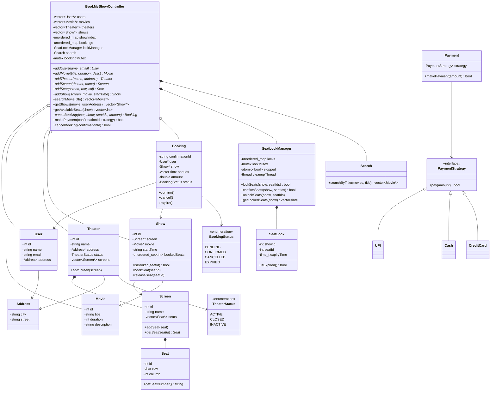
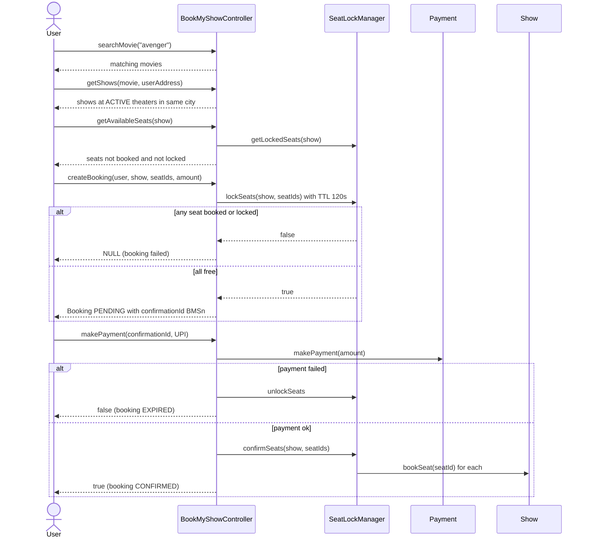
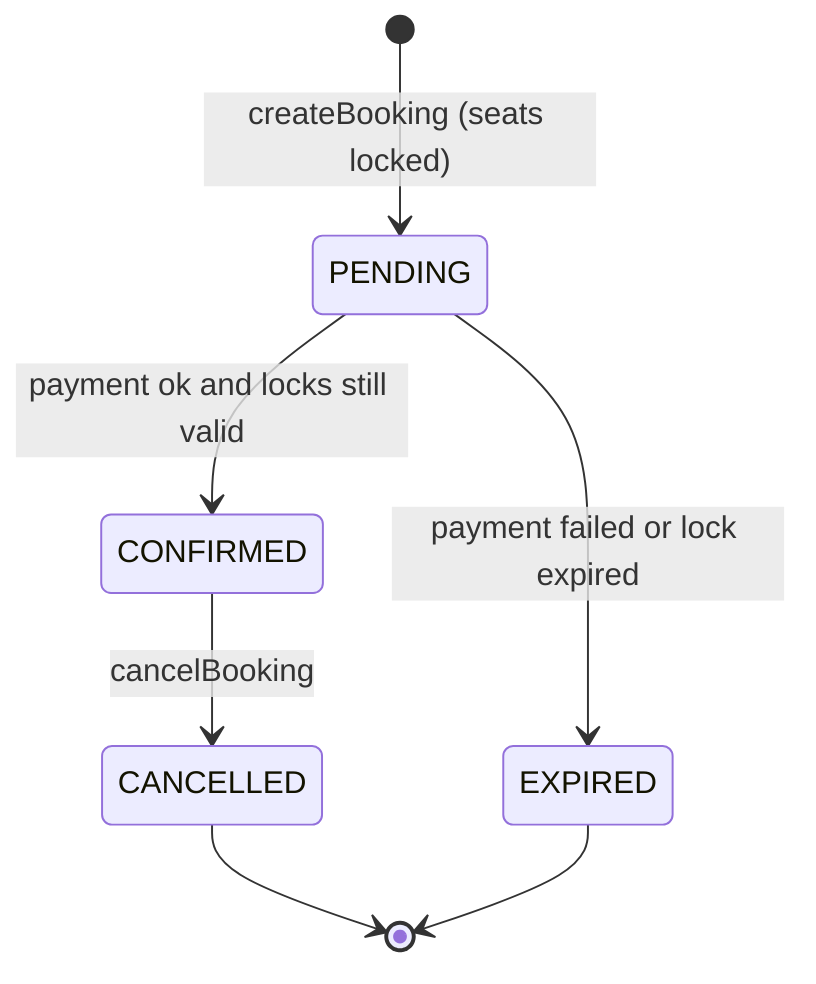

# BookMyShow (Movie Ticket Booking) — Low Level Design

[⬅ Back to index](../README.md)

**Code:** [`BookMyShow.cpp`](./BookMyShow.cpp) · C++17 · Notes: [`bookMyShow.txt`](./bookMyShow.txt)

## 1. Requirements

**Functional**
1. Users can **search movies by title** (case-insensitive substring match).
2. Users can **browse shows** of a movie — in code: shows at **ACTIVE theaters in the user's city**.
3. Theaters have **multiple screens**; all screens share the same seat layout (notes: rows A–Z, columns 0–20).
4. Users can **view available seats** for a show and select specific ones.
5. Users can **book multiple seats** in a single booking.
6. **Concurrent booking of the same seat** must be handled — only one user wins.
7. Users can **cancel a booking by confirmation ID**, which releases the seats.
8. **Payment processing** (UPI / Cash / Credit Card).

**Admin:** add theater, add screen/seats, add movie, add show, add user.

**User flow (from notes)**

> Search movie → list of movies → list of theaters / shows → available seats → select seats → **lock seats** → payment → seats booked

## 2. Core Entities

| Entity | Responsibility |
|---|---|
| `BookMyShowController` | Facade: owns users, movies, theaters, shows, bookings; ID generation; exposes all APIs |
| `User` | id, name, email, optional `Address` |
| `Movie` | id, title, duration (min), description |
| `Theater` | name, `Address`, `TheaterStatus`, list of `Screen`s |
| `Screen` | Owns the physical `Seat`s |
| `Seat` | id, row (`char`), column; `getSeatNumber()` → e.g. `A4` |
| `Show` | Movie × Screen × startTime; tracks **booked seat ids** (`unordered_set<int>`) |
| `SeatLock` | Temporary hold on (show, seat) with an **expiry time** |
| `SeatLockManager` | Locks / confirms / unlocks seats; background thread purges expired locks |
| `Booking` | confirmationId (`BMS<n>`), user, show, seatIds, amount, `BookingStatus` |
| `PaymentStrategy` (+ `UPI`, `Cash`, `CreditCard`) | Pluggable payment method |
| `Payment` | Context that delegates to a `PaymentStrategy` |
| `Search` | Title search over movies |
| `Address` | city, street (used for nearby-theater filtering) |
| `TheaterStatus` / `BookingStatus` | Enums |

## 3. Class Diagram



## 4. Design Patterns Used

| Pattern | Where | Why |
|---|---|---|
| **Strategy** | `PaymentStrategy` → `UPI` / `Cash` / `CreditCard`, used by `Payment` | Add new payment methods without touching booking logic (OCP) |
| **Facade / Controller** | `BookMyShowController` | Single entry point hiding seat locking, indexing, payment, ID generation |
| **Temporary lock with TTL** (pessimistic hold) | `SeatLock` + `SeatLockManager` | Holds seats while the user pays; auto-releases if abandoned |
| **Background cleaner thread** | `SeatLockManager::cleanup()` | Every 1 s purges expired locks so seats return to the pool |
| **Index (in-memory lookup)** | `showIndex : Movie → Theater → vector<Show*>` | Fast "shows of movie X at theater Y" lookup |

## 5. Key Flows

### Booking flow (lock → pay → confirm)



- **All-or-nothing locking:** `lockSeats` first checks *every* seat (booked? locked and unexpired?), and only then locks all of them.
- **Seat availability** = screen seats − `show.bookedSeats` − unexpired locks.
- **Lock expired before payment?** `confirmSeats` fails → booking marked `EXPIRED`.
- **Cancel:** `cancelBooking(confirmationId)` → only allowed if `CONFIRMED` → `show.releaseSeat()` for each seat → `CANCELLED`.
- **Lock key:** `"<showId>_<seatId>"` — locks are **per show**, so the same physical seat can be held in different shows.

### Booking state machine



## 6. Concurrency & Edge Cases

| Concern | How it's handled |
|---|---|
| **Two users booking the same seat** | `createBooking` runs under `bookingMutex`; `lockSeats` runs under `lockMutex` → check-then-lock is atomic. Second user gets `NULL` |
| **Abandoned checkout** | `SeatLock` has a **120 s expiry**; cleanup thread deletes expired locks every second; `lockSeats` also overwrites an expired lock |
| **Payment after lock expiry** | `confirmSeats` validates each lock exists and is unexpired → else booking `EXPIRED` |
| **Payment failure** | Seats unlocked, booking `EXPIRED` |
| **Double pay / pay on cancelled booking** | `makePayment` only proceeds if status is `PENDING` |
| **Cancel invalid / unconfirmed booking** | Unknown ID or non-`CONFIRMED` status → returns `false` |
| **Inactive / closed theaters** | Filtered out in `getNearbyTheaters` |
| **Graceful shutdown** | `~SeatLockManager` sets `atomic<bool> stopped`, joins the cleanup thread, frees locks |

Demo (`main`): Rahul wants seats 5,6,7 and Aman wants 7,8,9 on two threads → seat 7 overlaps → exactly one booking succeeds.

**Trade-offs worth mentioning**
- `bookingMutex` is a **single global lock** — simple and correct, but serializes all bookings across all shows (and the payment call runs while it's held). A per-show lock would scale better.
- Price is passed in by the caller (`seats × 200` in the demo); there is no pricing model per seat type.

## 7. How to Run

```bash
g++ -std=c++17 BookMyShow.cpp -o bookmyshow && ./bookmyshow
```

Sample output (thread order may vary):

```
Movies found: 1
Shows near user: 1
Show: 7:00 PM
Available seats: 1 2 3 4 5 6 7 8 9 10
Rahul seats locked. Confirmation ID: BMS1
Aman booking failed
UPI payment: 600
Rahul booking confirmed
```

---
### 🧠 Quick Revision
- **Show** (movie × screen × time) owns booking state — seats are physical, availability is **per show**.
- Booking is **two-phase**: `lockSeats` (TTL hold, status `PENDING`) → payment → `confirmSeats` (`CONFIRMED`).
- **All-or-nothing** seat locking under a mutex prevents double booking of overlapping seat sets.
- **TTL locks + background cleanup thread** release seats from abandoned checkouts.
- **Strategy pattern** for payments (UPI / Cash / CreditCard) — add a method without touching the controller.
- **`showIndex` (Movie → Theater → Shows)** + city filter on ACTIVE theaters powers show discovery.
- Cancellation by **confirmation ID** releases seats back to the show.
- Scale-up talking point: replace the global `bookingMutex` with per-show locks / DB row locks or Redis `SETNX` with TTL.
