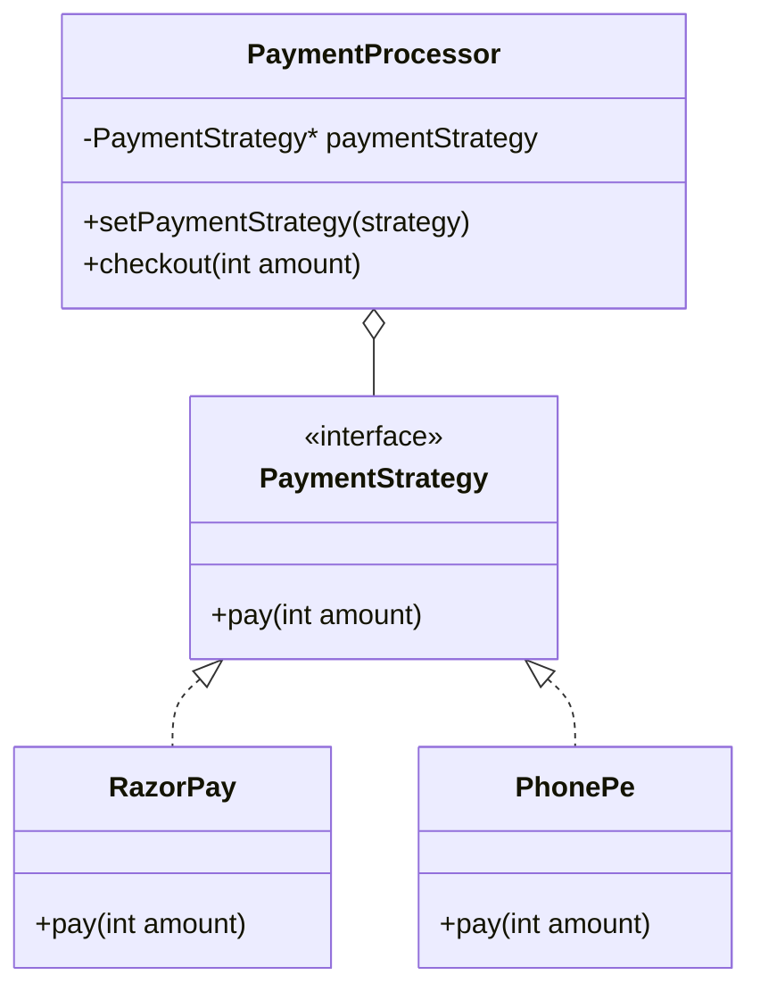
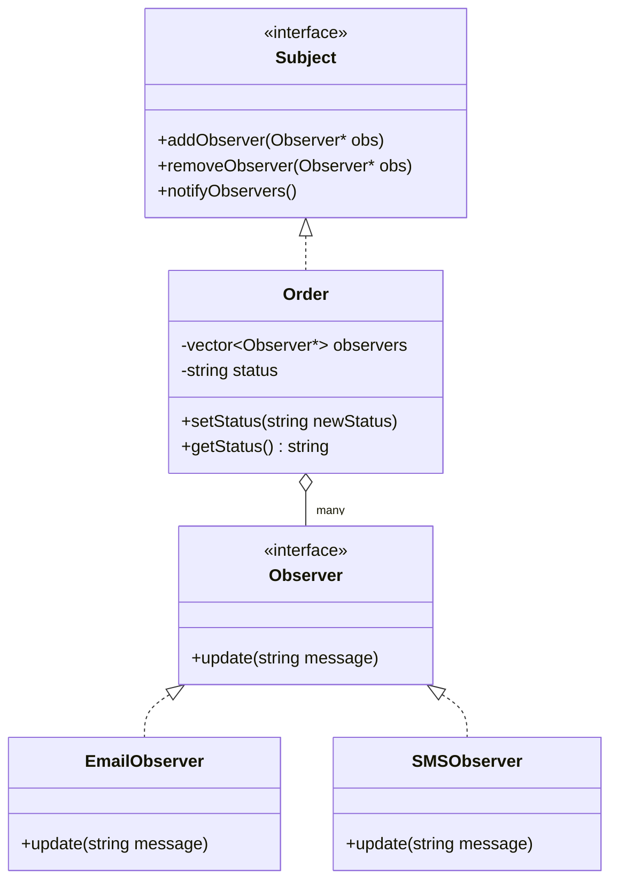
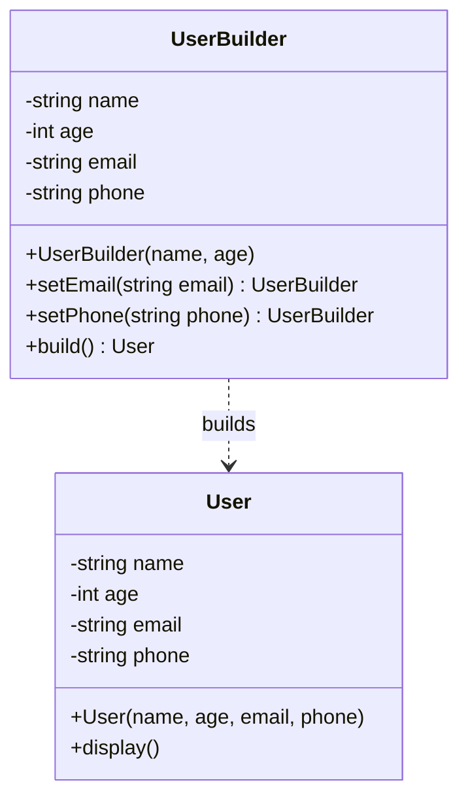
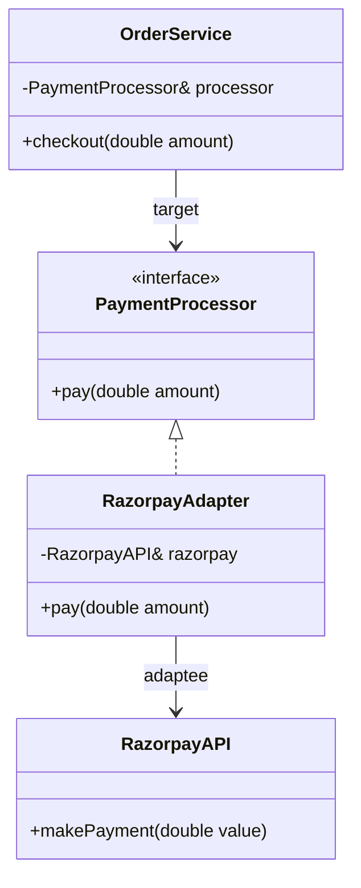
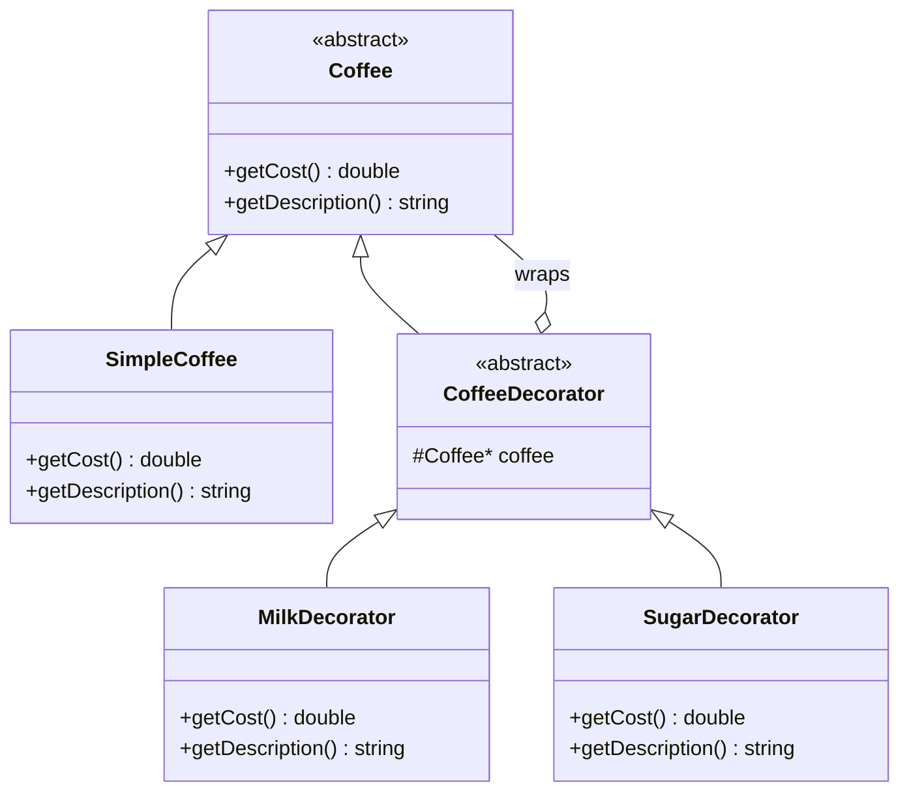

# Design Patterns (C++)

[⬅ Back to index](../README.md)

Five small, self-contained C++17 examples. Each file has its own `main()`.

| Pattern | Category | One-line intent | File |
|---|---|---|---|
| **Strategy** | Behavioral | Swap an algorithm at runtime behind a common interface | [`strategy_pattern.cpp`](./strategy_pattern.cpp) |
| **Observer** | Behavioral | When one object changes, notify all subscribers automatically | [`observer_pattern.cpp`](./observer_pattern.cpp) |
| **Builder** | Creational | Construct a complex object step by step, with optional parts | [`builder_design_pattern.cpp`](./builder_design_pattern.cpp) |
| **Adapter** | Structural | Make an incompatible interface fit the one your code expects | [`adapter_design_pattern.cpp`](./adapter_design_pattern.cpp) |
| **Decorator** | Structural | Add behaviour to an object dynamically by wrapping it | [`decorator_pattern.cpp`](./decorator_pattern.cpp) |

```bash
# run any of them
g++ -std=c++17 strategy_pattern.cpp -o strategy && ./strategy
```

---

## 1. Strategy (Behavioral)

**Intent:** Define a family of algorithms, put each in its own class, and make them **interchangeable at runtime**.

**When to use**
- Many `if/else` or `switch` branches choosing *how* to do something (payment mode, pricing, matching, sorting).
- You want to add a new variant **without modifying** the caller (**Open/Closed**).

**Problem solved in the example:** `PaymentProcessor` checks out an amount but shouldn't care whether it's card or UPI. It holds a `PaymentStrategy*`; `RazorPay` and `PhonePe` are concrete strategies, and `setPaymentStrategy()` switches mode at runtime.



```cpp
class PaymentStrategy {
    public:
    virtual void pay(int amount) = 0;
    virtual ~PaymentStrategy() {}
};

class PaymentProcessor {
    private:
    PaymentStrategy* paymentStrategy;
    public:
    void setPaymentStrategy(PaymentStrategy* strategy) {
        paymentStrategy = strategy;
    }
    void checkout(int amount) {
        paymentStrategy->pay(amount);
    }
};

// main
PaymentProcessor paymentProcessor(&card);
paymentProcessor.checkout(500);
paymentProcessor.setPaymentStrategy(&upi);
paymentProcessor.checkout(300);
```

Output: `paid 500 using Credit Card` → `paid 300 using UPI`

**Interview tip:** Strategy = **composition over inheritance** — the *context* (`PaymentProcessor`) **has-a** strategy rather than **is-a** payment type. Contrast with **State**: same structure, but in State the object switches its own behaviour based on internal state; in Strategy the **client** chooses.

---

## 2. Observer (Behavioral)

**Intent:** Define a **one-to-many** dependency so that when the **Subject** changes state, all **Observers** are notified automatically.

**When to use**
- Notifications / event systems (order status → email, SMS, push).
- Decoupling the thing that changes from the things that react to it.

**Problem solved in the example:** An `Order` (Subject) changes status; `EmailObserver` and `SMSObserver` must be told. `setStatus()` calls `notifyObservers()`, which loops over the registered observers. The `Order` knows nothing about email or SMS.



```cpp
class Order : public Subject {
    private:
    vector<Observer*>observers;
    string status;

    public:
    void addObserver(Observer* obs) override {
        observers.push_back(obs);
    }
    void removeObserver(Observer* obs) override {
        observers.erase(
            remove(observers.begin(), observers.end(), obs),
            observers.end()
        );
    }
    void setStatus(string newStatus) {
        status = newStatus;
        notifyObservers();
    }
    void notifyObservers() override {
        for (Observer* obs : observers) {
            obs->update(status);
        }
    }
};
```

**Interview tip:** Mention the **erase–remove idiom** used in `removeObserver`. Follow-ups to expect: *dangling observers* (Subject holds raw pointers — use `weak_ptr` or unsubscribe in the destructor), **thread safety** of the observer list, and **push vs pull** model (here it's **push** — the status string is passed in `update`).

---

## 3. Builder (Creational)

**Intent:** Separate the **construction** of a complex object from its representation, so it can be built **step by step** with only the parts you need.

**When to use**
- Constructors with many parameters, especially **optional** ones (avoids the "telescoping constructor" problem).
- You want readable, **fluent** creation code.

**Problem solved in the example:** `User` needs `name` and `age` (required) and `email` / `phone` (optional, default `""`). `UserBuilder` takes the required fields in its constructor, exposes chainable setters that `return *this`, and `build()` produces the `User`.



```cpp
class UserBuilder {
private:
    string name;
    int age;
    string email = "";   // optional
    string phone = "";   // optional
public:
    UserBuilder(string name, int age)
        : name(name), age(age) {}

    UserBuilder& setEmail(string email) {
        this->email = email;
        return *this;  // enables method chaining
    }
    UserBuilder& setPhone(string phone) {
        this->phone = phone;
        return *this;
    }
    User build() {
        return User(name, age, email, phone);
    }
};

User user = UserBuilder("Aman", 25).setEmail("aman@gmail.com").setPhone("9999999999").build();
```

**Interview tip:** Key trick is **returning `*this` by reference** for chaining. Put **required** fields in the builder's constructor, **validate** in `build()`, and you can make `User`'s constructor private + `friend class UserBuilder` so objects can *only* be made via the builder. Don't confuse with **Factory** (Factory picks *which* type to create; Builder controls *how* one object is assembled).

---

## 4. Adapter (Structural)

**Intent:** Convert the interface of an existing class into the interface the client expects, so incompatible classes can work together.

**When to use**
- Integrating a **third-party SDK / legacy API** whose method names or signatures don't match your interface.
- You can't (or shouldn't) modify the third-party class.

**Problem solved in the example:** `OrderService` depends on the `PaymentProcessor` interface (`pay(amount)`). The third-party `RazorpayAPI` only offers `makePayment(value)`. `RazorpayAdapter` implements `PaymentProcessor` and forwards `pay()` to `razorpay.makePayment()`.



```cpp
class RazorpayAPI {                     // adaptee (3rd-party)
public:
    void makePayment(double value) {
        cout << "Payment of " << value << " processed via Razorpay\n";
    }
};

class RazorpayAdapter : public PaymentProcessor {
private:
    RazorpayAPI& razorpay;
public:
    RazorpayAdapter(RazorpayAPI& razorpay)
        : razorpay(razorpay) {}

    void pay(double amount) override {
        razorpay.makePayment(amount);   // translate the call
    }
};

// main
RazorpayAPI razorpay;
RazorpayAdapter adapter(razorpay);
OrderService service(adapter);
service.checkout(2000);
```

**Interview tip:** Name the roles: **Target** (`PaymentProcessor`), **Adaptee** (`RazorpayAPI`), **Adapter** (`RazorpayAdapter`), **Client** (`OrderService`). This is an **object adapter** (composition); a **class adapter** would use multiple inheritance. Adapter **changes the interface**; Decorator **keeps** the interface and adds behaviour.

---

## 5. Decorator (Structural)

**Intent:** Attach extra responsibilities to an object **dynamically** by wrapping it in objects that share the same interface.

**When to use**
- Add-ons that can be combined freely (toppings, pricing add-ons, logging, compression).
- Subclassing every combination would cause a **class explosion** (`MilkSugarCoffee`, `MilkCoffee`, ...).

**Problem solved in the example:** Start with `SimpleCoffee` (cost 5). Wrap in `MilkDecorator` (+2) then `SugarDecorator` (+1). Each decorator **is-a** `Coffee` and **has-a** `Coffee`, delegating then adding its own part. Output: `Simple Coffee, Milk, Sugar` / `Total Cost: 8`.



```cpp
class CoffeeDecorator : public Coffee {
protected:
    Coffee* coffee;
public:
    CoffeeDecorator(Coffee* coffee) { this->coffee = coffee; }
    virtual ~CoffeeDecorator() { delete coffee; }
};

class MilkDecorator : public CoffeeDecorator {
public:
    MilkDecorator(Coffee* coffee) : CoffeeDecorator(coffee) {}
    double getCost() override { return coffee->getCost() + 2.0; }
    string getDescription() override {
        return coffee->getDescription() + ", Milk";
    }
};

// main
Coffee* coffee = new SimpleCoffee();
coffee = new MilkDecorator(coffee);
coffee = new SugarDecorator(coffee);
cout << coffee->getDescription() << endl;   // Simple Coffee, Milk, Sugar
cout << "Total Cost: " << coffee->getCost() << endl;  // 8
delete coffee;   // only delete outermost decorator
```

**Interview tip:** The decorator **owns** the wrapped object, so deleting the outermost one cascades down the chain (needs the **virtual destructor** in `Coffee`). In modern C++ prefer `unique_ptr<Coffee>` to make ownership explicit. Decorator vs Inheritance: decorators compose at **runtime**, inheritance is fixed at **compile time**.

---

### 🧠 Quick Revision

- **Strategy** → *how* to do it is pluggable; context **has-a** strategy, swap via setter. (Payment modes, pricing, matching.)
- **Observer** → Subject keeps a list, `notify()` loops and calls `update()`; **push** model here. (Order status → Email/SMS.)
- **Builder** → required fields in builder ctor, optional via chained setters returning `*this`, then `build()`.
- **Adapter** → wraps a 3rd-party class to match **your** interface — **changes** the interface. Roles: Target / Adaptee / Adapter / Client.
- **Decorator** → same interface, **wraps & adds** behaviour; stackable; avoids class explosion.
- Adapter vs Decorator vs Proxy: **change interface** / **add behaviour** / **control access** — all three wrap an object.
- All examples program to **interfaces** (pure virtual base + `virtual` destructor) → **Open/Closed** and **Dependency Inversion**.
- Memory: these demos use raw pointers/references; say you'd use **`unique_ptr` / `shared_ptr`** in production.

### Related: where these patterns are used in this repo

- [Uber](../Uber/README.md) — strategy, observer, builder, decorator, factory, singleton
- [BookMyShow](../BookMyShow/README.md) — strategy
- [Zepto](../Zepto/README.md) — strategy, factory, singleton
