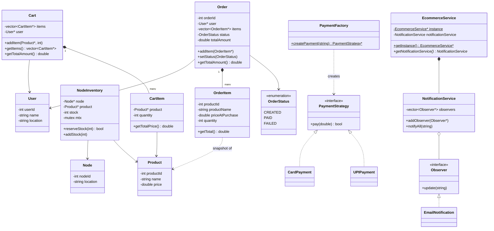
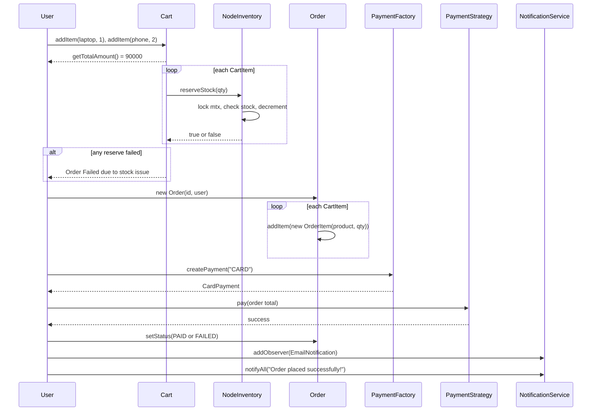
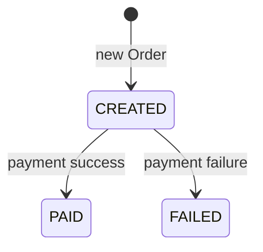

# E-commerce (Order Placement) — Low Level Design

[⬅ Back to index](../README.md)

**Code:** [`Ecommerce.cpp`](./Ecommerce.cpp) · C++17

## 1. Requirements

**Functional (what the code implements)**
- A **user** (ID, name, location) adds **products** with quantities to a **cart**.
- The cart computes its **total amount**.
- **Inventory is tracked per warehouse node:** `NodeInventory` = (Node, Product, stock).
- **Checkout:** reserve stock for every cart item. If any item is short, the **order fails**.
- Turn the cart into an **Order** made of `OrderItem`s that **snapshot the price at purchase time**.
- **Pay** with a chosen method (**Card** or **UPI**). The order status becomes `PAID` or `FAILED`.
- **Notify** subscribers (Email) after the order is placed.

**Out of scope / not implemented**
- Choosing a node by the user's location. `User` and `Node` both have a `location`, but the demo hard-codes one warehouse.
- Rolling back reserved stock on partial failure or on payment failure. `addStock` exists but is never called.
- Order cancellation, returns, shipping or delivery tracking, discounts, search or catalog.
- A real `placeOrder()` API. The checkout steps are written out in `main()`. `EcommerceService` only holds the notification service.

## 2. Core Entities

| Entity | Responsibility |
|---|---|
| `User` | User ID, name, location. |
| `Product` | Product ID, name, current price. |
| `Node` | Warehouse or fulfilment centre (ID, location). |
| `NodeInventory` | Stock of **one product at one node**. `reserveStock(qty)` and `addStock(qty)` are guarded by a **mutex**. |
| `CartItem` / `Cart` | Items the user wants to buy (product + qty). Totals use the **live** product price. |
| `OrderItem` | **Immutable snapshot**: productId, name, `priceAtPurchase`, qty. |
| `Order` | Order ID, user, order items, `OrderStatus`, running total. |
| `OrderStatus` (enum) | `CREATED`, `PAID`, `FAILED`. |
| `PaymentStrategy` → `CardPayment`, `UPIPayment` | Runs a payment. |
| `PaymentFactory` | Turns the string `"CARD"` or `"UPI"` into a strategy (`nullptr` otherwise). |
| `Observer` → `EmailNotification` | Receives notification messages. |
| `NotificationService` | Subject. Keeps a list of observers and calls `notifyAll(msg)`. |
| `EcommerceService` | **Singleton** that owns the `NotificationService` (it also has unused ID counters). |

## 3. Class Diagram



## 4. Design Patterns Used

| Pattern | Where | Why |
|---|---|---|
| **Singleton** | `EcommerceService::getInstance()` (lazy `new`) | One central service that holds shared things such as notifications. |
| **Strategy** | `PaymentStrategy` → Card / UPI | Payment modes can be swapped. Add a new mode without changing the checkout. |
| **Factory** | `PaymentFactory::createPayment(type)` | Makes the strategy from what the user picked, so the caller doesn't depend on concrete classes. |
| **Observer** | `NotificationService` (subject) + `Observer` / `EmailNotification` | Decouples order events from the notification channels (Email now, SMS or Push later). |
| **Snapshot / Value object** | `OrderItem` copies price and name | Later price changes don't affect past orders. |

## 5. Key Flows

### Checkout (as written in `main()`)



- **Reserve first, then create the order.** This stops overselling: stock is taken off before money is charged.
- `OrderItem` freezes `priceAtPurchase`. The cart total uses the live price, but the order total uses the snapshot.
- In the demo, inventory is chosen with a hard-coded `if product == laptop / phone`. In a real design an **InventoryManager** would choose the node (for example, the nearest to `User::location`).

### Order status



## 6. Concurrency & Edge Cases

| Concern | How the code handles it |
|---|---|
| Two buyers taking the last unit | `NodeInventory::reserveStock` does **check + decrement under a mutex** (**one lock per product per node**, which is fine-grained). |
| Not enough stock | `reserveStock` returns `false` → the loop breaks → "Order Failed due to stock issue". |
| Restock / release | `addStock` is also locked. |

**Gaps worth mentioning in an interview**
- **No rollback:** if item 2 fails, the stock already reserved for item 1 is **not released**. A failed payment does not release stock either. The fix is to call `addStock` as a compensating action, or use a reservation with a TTL.
- **Singleton is not thread-safe.** Lazy `if (!instance) instance = new ...` can race. Use a function-local `static` (Meyers singleton) instead. The instance is also never deleted.
- `PaymentFactory` returns `nullptr` for an unknown type, but `main` calls `payment->pay()` **without a null check**.
- `Observer` has **no virtual destructor**. `NotificationService::observers` is not locked.
- Most `new`ed objects (`User`, `Product`, `Cart`, `Order`, `OrderItem`s, observers) are **never freed**. Smart pointers (`unique_ptr` / `shared_ptr`) would fix this. `<memory>` is included but not used.
- The notification is sent no matter how the payment went, and the observer is registered right before it is sent.
- Unused fields: `NodeInventory::node`, `Order::orderId` (compiler warnings), `Cart::user`, and the counters in `EcommerceService`.

## 7. How to Run

```bash
g++ -std=c++17 Ecommerce.cpp -o ecommerce && ./ecommerce
```

Expected output:
```
Cart Total: 90000
Order Created. Total: 90000
Paid 90000 via Card
Payment Successful
[Email] Order placed successfully!
```

---
### 🧠 Quick Revision
- **Flow:** Cart → reserve inventory → Order (from OrderItems) → Payment → status → notify.
- **Inventory per node** (`NodeInventory` = node + product + stock) lets one product be stocked in many warehouses.
- **Concurrency:** a **mutex per inventory row** makes check-and-decrement atomic, so nothing is oversold.
- **OrderItem snapshots the price.** Order history stays correct after price changes.
- **Strategy + Factory** for payments (Card/UPI). **Observer** for notifications (Email, easy to add more). **Singleton** for the service.
- **Order state machine:** `CREATED → PAID / FAILED`.
- **Improvements to suggest:** compensating rollback (`addStock`) on failure, node selection by user location, thread-safe Meyers singleton, smart pointers, a proper `placeOrder()` method in the service.
