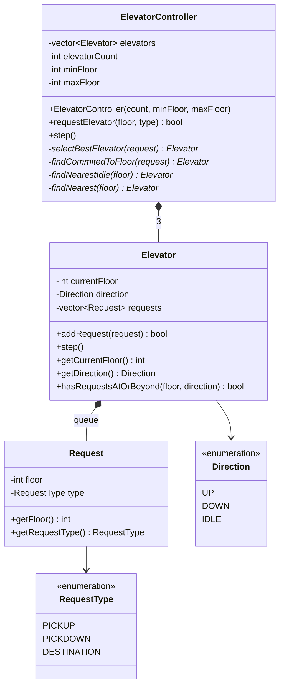
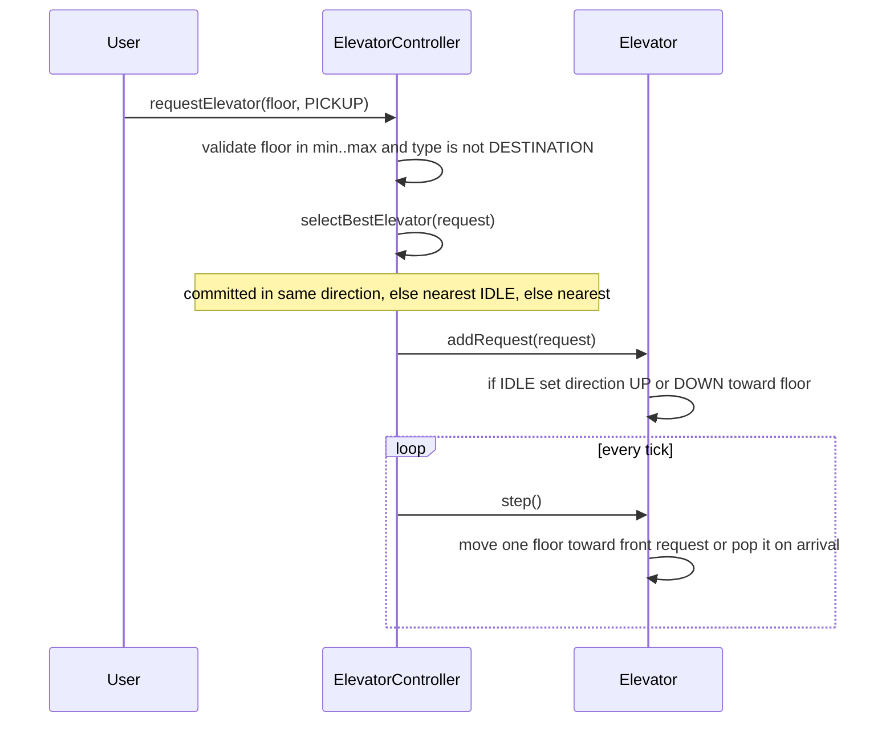
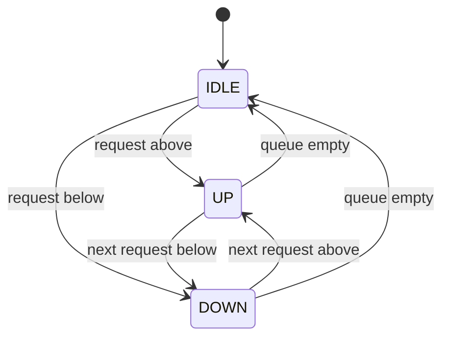

# Elevator System — Low Level Design

[⬅ Back to index](../README.md)

**Code:** [`Elevator.cpp`](./Elevator.cpp) · C++17

## 1. Requirements

1. System manages **3 elevators** and **10 floors** (the demo `main` uses floors `0..20`).
2. User can **request an elevator from any floor** (up or down); the **system decides** which elevator to dispatch.
3. Once inside, user can select **one or more destination floors**.
4. Elevator stops come in **2 types**:
   - **Request (hall) calls** — from a floor, with direction up / down.
   - **Destination (car) calls** — from inside the elevator (a floor number).
5. System handles **multiple concurrent pickup requests** across floors.
6. **Invalid requests are rejected.**

**Out of scope**
- Weight capacity and passenger limits.
- Emergency stop functionality.

## 2. Core Entities

| Entity | Responsibility |
|---|---|
| **ElevatorController** | Owns all elevators, validates hall requests, **selects the best elevator**, advances the simulation (`step`) |
| **Elevator** | Tracks `currentFloor`, `direction`, pending `requests`; moves one floor per `step()` |
| **Request** | A stop: `floor` + `RequestType` |
| **RequestType** (enum) | `PICKUP` (hall call going up), `PICKDOWN` (hall call going down), `DESTINATION` (car call) |
| **Direction** (enum) | `UP`, `DOWN`, `IDLE` |
| ~~Floor~~ | Not modelled — a floor is just an `int` with no behaviour |
| User | Listed in notes as an actor; not a class in code |

## 3. Class Diagram



## 4. Design Patterns Used

| Pattern | Where | Why |
|---|---|---|
| **Controller / Facade** | `ElevatorController` | Single entry point for hall calls; hides elevator selection and simulation from callers |
| **Chain of fallbacks (dispatch heuristic)** | `selectBestElevator` → committed → nearest idle → nearest any | Prefer elevators already heading toward the caller, then idle ones, then whoever is closest |
| **Tick-based simulation** | `step()` on controller and elevators | Deterministic, easy to reason about; one floor move per tick |

> Natural extension: extract the dispatch heuristic into a **Strategy** (`ElevatorSelectionStrategy`) so alternatives (SCAN/LOOK, least-load) can be swapped in.

## 5. Key Flows

### Hall call → dispatch → movement



**Elevator selection (`selectBestElevator`):**
1. **Committed elevator** — moving in the requested direction (`PICKUP`→UP, `PICKDOWN`→DOWN), has **not passed** the floor yet, and already has requests **at or beyond** that floor → pick the nearest such.
2. **Nearest IDLE** elevator.
3. **Nearest elevator** overall (fallback).

**Movement (`Elevator::step`):**
- Requests are served **FIFO** (front of the vector).
- Below target → `currentFloor++`, UP; above → `currentFloor--`, DOWN; at target → pop request (becomes IDLE when queue empties).
- Empty queue → IDLE.

### Elevator direction states



## 6. Concurrency & Edge Cases

- **Invalid input rejected** by `requestElevator` (returns `false`):
  - Floor outside `[minFloor, maxFloor]`.
  - `DESTINATION` type on the hall-call API.
  - No elevator available (`nullptr`).
- Request at the **current floor** of an idle elevator → direction stays IDLE; served on the next `step()`.
- **Concurrency:** the code is **single-threaded** — there is **no mutex**. "Concurrent pickup requests" are handled logically (many queued requests across elevators, served tick by tick). For real threads, guard `requestElevator` and `step` with a mutex on the controller (or per-elevator locks).
- **Gaps vs. requirements (mention if asked):**
  - **Destination calls** are not exposed through the controller (`Elevator::addRequest` supports them, but there is no API to reach a specific elevator from inside).
  - Requests are **FIFO**, not SCAN/LOOK — an elevator does not stop at intermediate requested floors on the way.
  - No duplicate-request check; `addRequest` always returns `true`.

## 7. How to Run

```bash
g++ -std=c++17 Elevator.cpp -o elevator && ./elevator
```

Output: `Elevator simulation completed.` (the demo issues 3 hall calls and runs 15 ticks; no per-step logging).

---
### 🧠 Quick Revision

- **Entities:** `ElevatorController` → many `Elevator`s → queue of `Request{floor, type}`; enums `RequestType` and `Direction`. Floor is just an `int`.
- **Two call types:** hall calls (`PICKUP`/`PICKDOWN`, dispatched by controller) vs. destination calls (`DESTINATION`, from inside the car).
- **Dispatch heuristic:** committed-in-same-direction & not yet passed → nearest idle → nearest overall.
- **Movement:** tick-based `step()`, one floor per tick, FIFO queue; direction derived from target, IDLE when empty.
- **Validation:** out-of-range floor or wrong request type → rejected (`false`).
- **Improvements to pitch:** SCAN/LOOK ordering (sorted up/down sets), Strategy for dispatch, mutex for thread safety, destination API per elevator, capacity & emergency stop.
