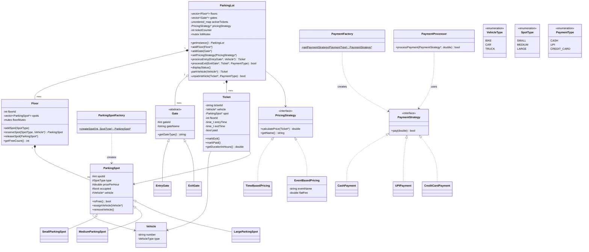
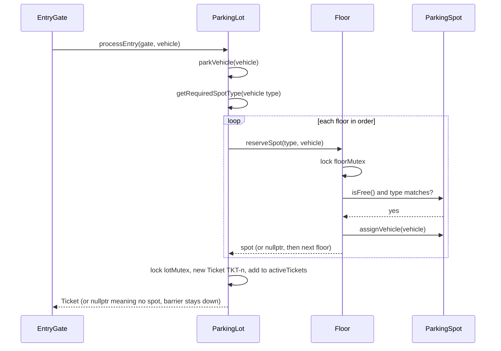
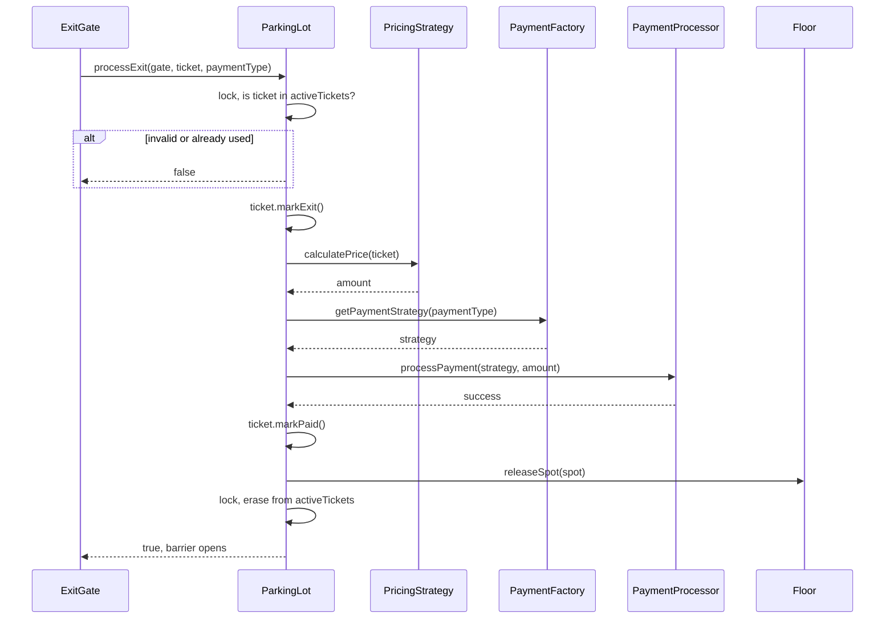
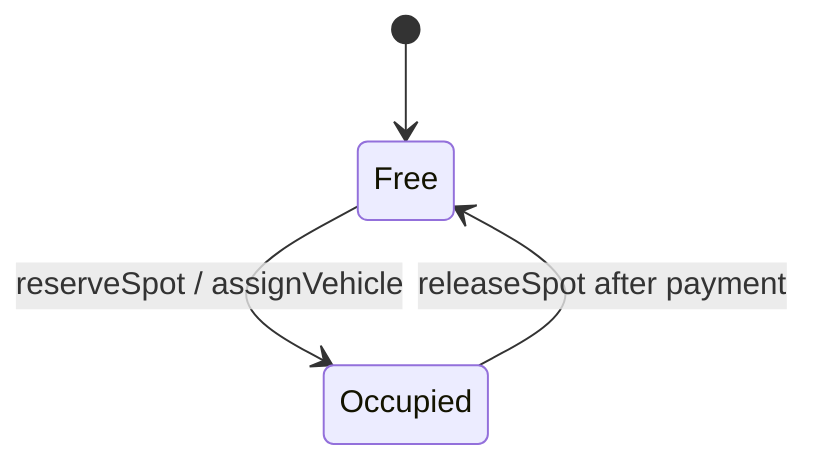

# Parking Lot — Low Level Design

[⬅ Back to index](../README.md)

**Code:** [`ParkingLot.cpp`](./ParkingLot.cpp) · C++17

## 1. Requirements

**Functional**
- A parking lot has **multiple entry and exit gates**.
- The lot has **multiple floors**; each floor has **multiple parking spots**.
- Each spot has a **type** (`SMALL`, `MEDIUM`, `LARGE`), and each type has its own **hourly price** (10 / 20 / 30).
- Vehicle → spot mapping: `BIKE → SMALL`, `CAR → MEDIUM`, `TRUCK → LARGE` (exact match only).
- **On entry:** find a free spot of the right type (scanning floors in order), park the vehicle, **generate a ticket**.
- **On exit:** present the ticket, **calculate the price**, **pay**, **release the spot**.
- **Pricing** can be changed at runtime: **time-based** (hours × spot rate, minimum 1 hour, rounded up) or **event-based** (flat fee).
- **Multiple payment modes:** Cash, UPI, Credit Card.
- Show the lot status: free and filled spots per floor, plus a total.
- Handle **concurrency**: two vehicles must never get the same spot.

**Out of scope (not in the code)**
- Fallback to a bigger spot when the exact type is full (for example, a bike in a MEDIUM spot).
- Real payment failures or retries. Every payment strategy returns `true`.
- Reservations in advance, EV charging, a display board per gate, persistence.
- Blocking the same vehicle from entering twice.

## 2. Core Entities

| Entity | Responsibility |
|---|---|
| `ParkingLot` | **Singleton** facade. Holds floors, gates, active tickets and the current pricing strategy. Runs the entry and exit flows. |
| `Floor` | Owns its `ParkingSpot`s. Reserves and releases spots under its **own mutex**. Spot IDs are `floorId*100 + n`. |
| `ParkingSpot` (+ `Small/Medium/LargeParkingSpot`) | Spot ID, type, price per hour, occupied flag, the parked vehicle. |
| `ParkingSpotFactory` | Creates the right spot subclass from a `SpotType`. |
| `Vehicle` | Number plate and `VehicleType`. |
| `Ticket` | ID (`TKT-n`), vehicle, spot, floor, entry and exit time, paid flag. Computes the billable hours. |
| `Gate` (abstract) → `EntryGate`, `ExitGate` | Gate ID and name. Gives the type of gate. |
| `PricingStrategy` → `TimeBasedPricing`, `EventBasedPricing` | Computes the amount for a ticket. |
| `PaymentStrategy` → `CashPayment`, `UPIPayment`, `CreditCardPayment` | Runs a payment. |
| `PaymentFactory` | Turns a `PaymentType` into a `PaymentStrategy`. |
| `PaymentProcessor` | Checks that a strategy exists (not null), then calls `pay()`. |

## 3. Class Diagram



## 4. Design Patterns Used

| Pattern | Where | Why |
|---|---|---|
| **Singleton** | `ParkingLot::getInstance()` (static local, copy is deleted) | One lot instance shared by all gates. A static local is thread-safe to create in C++11 and later. |
| **Factory** | `ParkingSpotFactory::createSpot` | `Floor` does not need to know the concrete spot classes. Add a new spot type in one place. |
| **Factory** | `PaymentFactory::getPaymentStrategy` | Maps the `PaymentType` the user picks at the exit gate to a concrete strategy. |
| **Strategy** | `PricingStrategy` (Time / Event) | Change the pricing rule at runtime (for example, on an IPL match day) without touching `ParkingLot`. |
| **Strategy** | `PaymentStrategy` (Cash / UPI / Card) | Each payment mode is its own class. Open/Closed for new modes. |
| **Facade** (implicit) | `processEntry` / `processExit` | Gates call two simple methods. Spot search, tickets, pricing and payment stay hidden inside. |

## 5. Key Flows

### Entry → park → ticket



### Exit → price → pay → release



- **Spot search is first-fit:** floors are checked in the order they were added, and spots inside a floor in the order they were added.
- **Time-based price** = `ceil(hours)` × `pricePerHour` of the spot, with a **minimum of 1 hour**. Event-based ignores time and returns a flat fee.
- If payment fails, the spot is **not** released and the ticket stays active.
- `activeTickets` is the source of truth for "already used". After a successful exit the ticket is removed, so using it again is rejected.

### Spot state



## 6. Concurrency & Edge Cases

| Concern | How the code handles it |
|---|---|
| Two cars racing for the same spot | `Floor::reserveSpot` does check-free + assign under **`floorMutex`** in one step. It is **locked per floor**, so different floors don't block each other. |
| Ticket counter and maps | `generateTicketId`, `activeTickets` and `allTickets` are changed under **`lotMutex`**. |
| Free-count / status reads | `getFreeCount` and `getTotalCount` take `floorMutex`. |
| Lot is full | `parkVehicle` returns `nullptr` → "No spot available. Barrier stays down." |
| Ticket reused or invalid | Not found in `activeTickets` → "Invalid or already used ticket." |
| Null ticket at exit | "No ticket presented." |
| No pricing configured | Exit fails with "No pricing strategy configured." |
| Invalid payment type | `PaymentFactory` returns `nullptr` → `PaymentProcessor` rejects it. |
| Memory | `Floor` deletes its spots. `ParkingLot` deletes its floors and all tickets. Gates and vehicles are owned by the caller. |

**Gaps worth mentioning in an interview**
- `unparkVehicle` checks `activeTickets` under the lock, **releases the lock**, and only erases at the end. Two exits running at the same time with the same ticket could **both pass the check and both pay** (a check-then-act race). The fix is to remove the ticket or mark it "in progress" atomically at the start.
- `pricingStrategy`, `floors` and `gates` are read and written **without a lock**. That is fine for setup on one thread, but a call to `setPricingStrategy` during traffic is a data race. `setPricingStrategy(nullptr)` would also crash, because it calls `getName()` on the pointer.
- The code comments say Ticket → Payments is 1:M, but the code makes **one payment per exit**.

## 7. How to Run

```bash
g++ -std=c++17 ParkingLot.cpp -o parkinglot && ./parkinglot
```

The demo sets up 2 floors (4 + 2 spots) and 3 gates. It parks a car, a bike and a truck. The car's exit is backdated by 3 hours and paid by UPI under time-based pricing (Rs. 60). The demo then switches to event pricing (Rs. 500 flat) for the other exits, tries to reuse a ticket (rejected), and fills the MEDIUM spots until "No spot available".

---
### 🧠 Quick Revision
- **Entities:** ParkingLot → Floors → Spots. Gates for entry and exit. A Ticket ties together Vehicle, Spot and Floor.
- **Singleton** ParkingLot. **Factory** for spots and payments. **Strategy** for pricing (time/event) and payment (cash/UPI/card).
- Vehicle type maps to a spot type. **First-fit** search across floors.
- **Concurrency:** a **mutex per floor** makes "check free + assign" atomic, so the same spot is never given twice. A **lot mutex** guards the ticket counter and the active-ticket map.
- Price = `ceil(hours)` × rate (min 1 hr), or a flat event fee. The strategy can be swapped at runtime.
- On exit the steps are: validate ticket → price → pay → mark paid → release spot → remove the active ticket. If payment fails, the spot stays taken.
- **Known gap:** validating and consuming the ticket is not atomic (double-exit race). Pricing strategy changes are not locked. No fallback to a larger spot.
