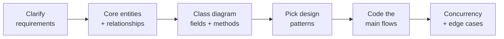

# Low Level Design (LLD) in C++

My LLD / machine-coding practice for interview prep. Each system has runnable C++17 code and a README with requirements, class diagram, design patterns, key flows, concurrency notes and a quick-revision list.

> High Level Design notes are in a separate repo: [system-design-hld](https://github.com/Ravindra230105/system-design-hld)

## Systems

| # | System | Design patterns | Highlights | Status |
|---|--------|-----------------|------------|--------|
| 1 | [BookMyShow](./BookMyShow/README.md) | Strategy, Facade | Seat locking with expiry (`SeatLockManager`), concurrent booking of the same seat | ✅ Runs |
| 2 | [Uber](./Uber/README.md) | Strategy, Observer, Builder, Decorator, Factory, Singleton | Ride state machine, mutex-protected driver assignment, stackable fare decorators | ✅ Runs |
| 3 | [Parking Lot](./ParkingLot/README.md) | Singleton, Factory, Strategy, Facade | Spot allocation, pricing strategies, ticket validation | ✅ Runs |
| 4 | [Elevator](./Elevator/README.md) | Controller / Facade | Dispatching across 3 elevators, pickup vs destination requests | ✅ Runs |
| 5 | [Zepto (Quick Commerce)](./Zepto/README.md) | Singleton, Strategy, Factory, Facade | Per-node inventory with locking, cart → order → payment, discounts | ⚠️ See README |
| 6 | [E-commerce](./Ecommerce/README.md) | Singleton, Strategy, Factory, Observer | Inventory reservation, checkout, notifications | ✅ Runs |
| 7 | [Social Media](./SocialMedia/README.md) | – | Users, posts, media, follow model | 🚧 Work in progress |

## Design Patterns

[**Design Patterns guide →**](./DesignPattern/README.md): Strategy, Observer, Builder, Adapter and Decorator, each with a class diagram, a code snippet and an interview tip.

| Pattern | Type | Example |
|---|---|---|
| Strategy | Behavioral | [strategy_pattern.cpp](./DesignPattern/strategy_pattern.cpp) |
| Observer | Behavioral | [observer_pattern.cpp](./DesignPattern/observer_pattern.cpp) |
| Builder | Creational | [builder_design_pattern.cpp](./DesignPattern/builder_design_pattern.cpp) |
| Adapter | Structural | [adapter_design_pattern.cpp](./DesignPattern/adapter_design_pattern.cpp) |
| Decorator | Structural | [decorator_pattern.cpp](./DesignPattern/decorator_pattern.cpp) |

---

## Approach for any LLD interview



1. **Requirements:** functional requirements, plus what's out of scope.
2. **Core entities:** nouns become classes; note relationships (has-a / is-a, 1:N).
3. **Class diagram:** fields, methods, enums for status/types.
4. **Design patterns:** Strategy for swappable algorithms (pricing, payment, matching), Observer for notifications, Factory/Builder for object creation, Singleton for the central manager, State or a transition table for lifecycles.
5. **Main flows:** code the happy path end-to-end in `main()`.
6. **Concurrency + edge cases:** locks on shared resources (seats, drivers, inventory), invalid input, double-booking / double-payment.

## How to run

```bash
g++ -std=c++17 BookMyShow/BookMyShow.cpp -o bms && ./bms
```

> On macOS, files using `#include <bits/stdc++.h>` need GCC (`brew install gcc`, then use `g++-15`). Apple clang doesn't ship that header.
