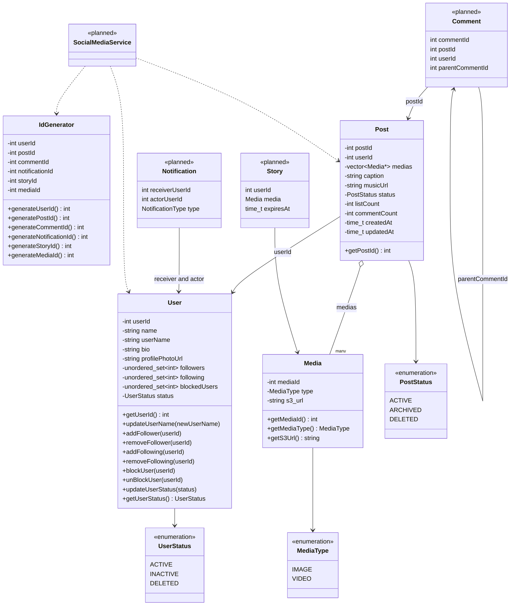
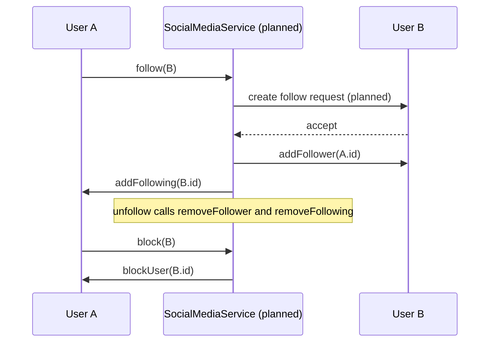

# Social Media (Instagram) — Low Level Design

[⬅ Back to index](../README.md)

**Code:** [`SocialMedia.cpp`](./SocialMedia.cpp) · C++17

> ⚠️ **Status: work in progress.** The file contains the full requirement/class/attribute plan (as comments) but only **`IdGenerator`, `Media`, `User`** and a stub of **`Post`** are implemented. There is **no `main()`** and the file does **not compile yet** (see [§7](#7-how-to-run)). Sections below separate **implemented** from **planned** so revision stays honest.

## 1. Requirements

From the header comments in the code:

| # | Requirement | Implemented? |
|---|---|---|
| R1 | User can register / login | ❌ planned |
| R2 | Follow / unfollow via **follow request** (accept / decline) | 🟡 partial — `User` keeps `followers` / `following` sets; no request flow |
| R3 | Upload posts (images / videos) | 🟡 `Media` done, `Post` is a stub |
| R4 | Comment on posts (nested via `parent_comment_id`) | ❌ planned |
| R5 | Notifications: follow request, new post to followers | ❌ planned (`NotificationType` enum exists) |
| R6 | Like / unlike posts | ❌ planned |
| R7 | Delete post | 🟡 `PostStatus::DELETED` enum exists |
| R8 | View feed / posts from followed users | ❌ planned |
| R9 | Public & private accounts | ❌ planned |
| R10 | Block / unblock user | ✅ `User::blockUser / unBlockUser` |
| R11 | Followers & following listing | 🟡 data held in sets, no getters yet |
| R12 | Save post / reel | ❌ planned |
| R13 | User search | ❌ planned (`UserSearch` class listed) |
| R14 | Stories (with expiry) | ❌ planned |

## 2. Core Entities

| Entity | Responsibility | State in code |
|---|---|---|
| **`IdGenerator`** | Hands out auto-incrementing ids for user, post, comment, notification, story, media | ✅ implemented |
| **`Media`** | One image/video: `mediaId`, `MediaType`, `s3_url` (blob stored in S3, only the URL in the object) | ✅ implemented |
| **`User`** | Profile (`name`, `userName`, `bio`, `profilePhotoUrl`), **`unordered_set<int>`** of `followers`, `following`, `blockedUsers`, `UserStatus` | ✅ implemented |
| **`Post`** | `postId`, `userId`, `vector<Media*>`, `caption`, `musicUrl`, `PostStatus`, like/comment counters, `createdAt` / `updatedAt` | 🟡 fields + `getPostId()` only |
| `Comment` | `comment_id`, `post_id`, `user_id`, `like_count`, **`parent_comment_id` (-1 = root)** for threaded replies | ❌ planned |
| `Notification` | `receiverUserId`, `actorUserId`, `action_type`, content, read/unread | ❌ planned |
| `Story` | `user_id`, `Media`, viewers list, like count, **`expires_at`** | ❌ planned |
| `UserSearch` | Search users | ❌ planned |
| `SocialMediaService` | Facade / orchestrator over all of the above | ❌ planned |

**Enums:** `MediaType {IMAGE, VIDEO}`, `NotificationType {FOLLOW, LIKE, COMMENT}`, `UserStatus {ACTIVE, INACTIVE, DELETED}`, `PostStatus {ACTIVE, ARCHIVED, DELETED}`.

## 3. Class Diagram

Implemented classes (solid) plus the main planned ones (marked `<<planned>>`).



## 4. Design Patterns Used

The current code is mostly a domain model, so few patterns are actually wired in yet.

| Pattern / Idea | Where | Why |
|---|---|---|
| **Centralised ID generation** | `IdGenerator` | One place to mint ids per entity type. A natural **Singleton** candidate (not a singleton yet — it is a plain class). |
| **Reference by id** (not pointer) | `User` stores follower/following/blocked as `int` ids; `Post` stores `userId` | Avoids object graphs / ownership cycles between users; mirrors how a DB would store it. |
| **Enum-based state** | `UserStatus`, `PostStatus` | **Soft delete / archive** — `DELETED` / `ARCHIVED` instead of physically erasing. |
| **Facade** *(planned)* | `SocialMediaService` | Single entry point that orchestrates users, posts, notifications. |
| **Observer** *(planned, natural fit)* | `Notification` + `NotificationType` | Followers get notified on new post / follow / like / comment. Not implemented in this file. |

## 5. Key Flows

Only the **follow / block** primitives exist on `User`. The sequence below shows the intended follow flow; the `SocialMediaService` / follow-request steps are **planned**, the `User` calls are **real methods**.



- **Follow** is a **two-sided update**: `B.addFollower(A)` **and** `A.addFollowing(B)` — both must happen together (keep consistent).
- **Unfollow** is the mirror: `removeFollower` + `removeFollowing`.
- **Block** only updates the blocker's `blockedUsers` set; enforcement (hiding posts, removing follow edges) is not written yet.
- `unordered_set` gives **O(1)** follow/unfollow/block checks and naturally prevents duplicates.

## 6. Concurrency & Edge Cases

**In the code today**

- **No thread safety** — `IdGenerator` uses plain `int` counters with `++`; concurrent calls could hand out duplicate ids. Fix: `std::atomic<int>` or a mutex.
- 🐞 **Bug:** `User::updateUserStatus(UserStatus status) { status = status; }` — the parameter **shadows** the member, so it is a **self-assignment no-op**; the user's status never changes. Should be `this->status = status;`.
- **Compile error:** `class Post { ... }` is missing the trailing `;` (end of file).
- `Post` has **no constructor**, so its fields cannot be initialised yet; `listCount` is presumably meant to be a like count.
- `Post` holds raw `Media*` — ownership is unclear (who deletes?). Prefer `shared_ptr<Media>` / `unique_ptr`.

**To handle when completing the design**

- Following yourself, following a user who has blocked you, duplicate follow requests.
- Private account → posts visible only to accepted followers.
- Like/unlike idempotency (a set of liker ids per post, not just a counter).
- Deleting a post → soft delete via `PostStatus::DELETED`, cascade to comments.
- Story expiry (`expires_at`) — filter out on read or a cleanup job.

## 7. How to Run

```bash
g++ -std=c++17 SocialMedia.cpp -o socialmedia && ./socialmedia
```

> ❗ Currently **fails to compile**: `error: expected ';' after class` at the end of `Post`, and there is **no `main()`** (it would then fail at link time). Add the `;` and a `main()` that exercises `User` / `Media` to run it.

---

### 🧠 Quick Revision

- **Entities:** `User`, `Post`, `Media`, `Comment`, `Story`, `Notification` + `IdGenerator` and a `SocialMediaService` facade.
- **Follow graph** = two `unordered_set<int>` per user (`followers`, `following`) → O(1) ops, no duplicates; follow updates **both sides**.
- **Store ids, not pointers**, for relations between users — avoids cycles and maps cleanly to DB tables.
- **Media** stores only an **S3 URL** + type; blobs live in object storage.
- **Nested comments** via `parent_comment_id` (-1 = root) — a tree in a flat table.
- **Soft delete** with status enums (`ACTIVE / ARCHIVED / DELETED`).
- Notifications on post/follow/like/comment are a textbook **Observer** use-case; **IdGenerator** → **Singleton + atomic counters**.
- Watch for **parameter shadowing** bugs (`status = status;`) — a classic interview gotcha.
