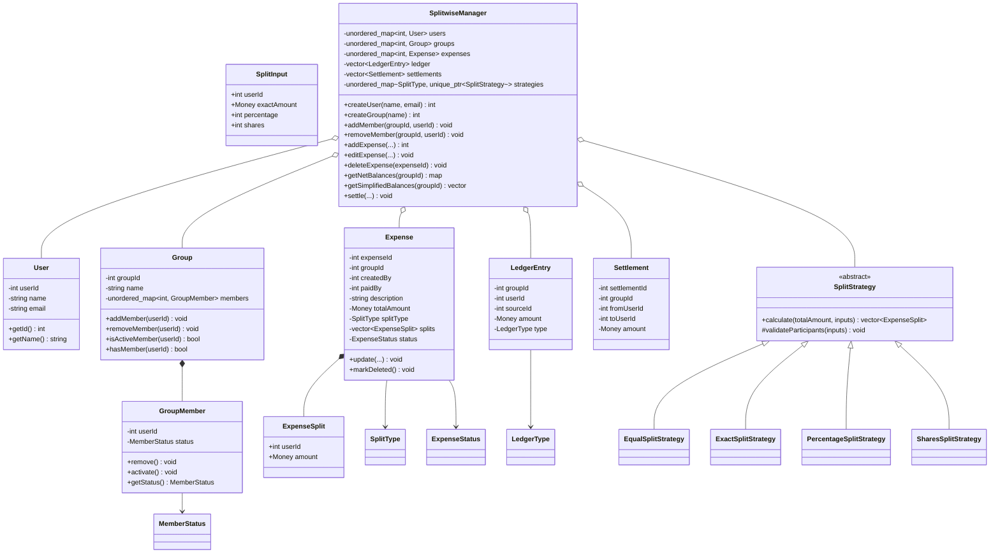
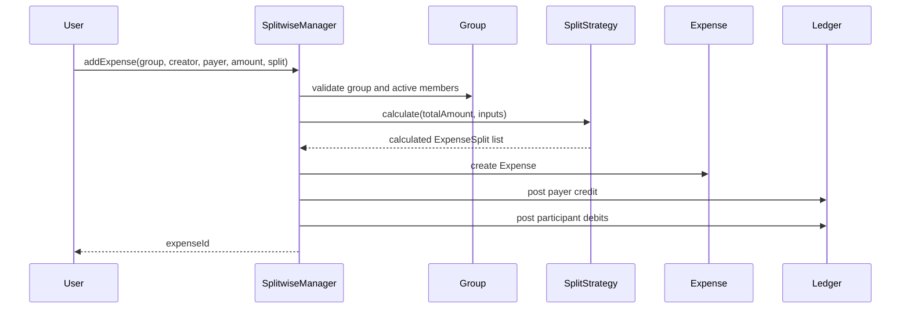
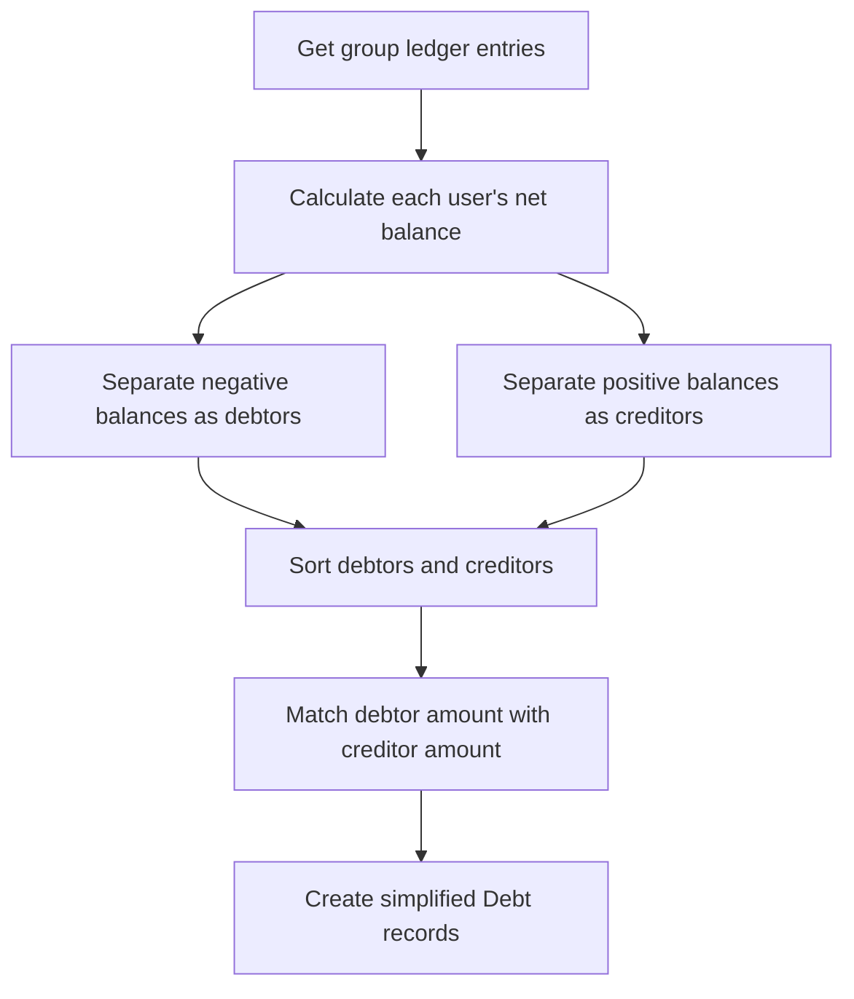

# Splitwise — Low Level Design

**Code:** `Splitwise.cpp` · C++17

> **Status:** The current implementation contains the core in-memory expense-sharing flow: users, groups, membership, four split strategies, expenses, ledger entries, balance calculation, expense edit/delete, and manual settlements. Notifications, actual payment-gateway integration, persistence, and concurrency control are not implemented. This README distinguishes implemented behavior from requirements that remain outside the current code.

---

## 1. Requirements

### Functional requirements

| # | Requirement | Implemented? |
|---|---|---|
| R1 | Create users with name and email | ✅ `createUser()` |
| R2 | Create groups | ✅ `createGroup()` |
| R3 | Add or remove members from a group | ✅ `addMember()` / `removeMember()` |
| R4 | Add an expense with creator, payer, amount, description, and participants | ✅ `addExpense()` |
| R5 | Split equally among participants | ✅ `EqualSplitStrategy` |
| R6 | Split using exact amounts | ✅ `ExactSplitStrategy` |
| R7 | Split using percentages | ✅ `PercentageSplitStrategy` |
| R8 | Split using shares (for example, 2:1:1) | ✅ `SharesSplitStrategy` |
| R9 | Edit an existing active expense | ✅ `editExpense()` |
| R10 | Delete an existing active expense | ✅ `deleteExpense()` |
| R11 | Maintain a ledger of financial changes | ✅ expense, reversal, and settlement entries |
| R12 | View each user's net balance in a group | ✅ `getNetBalances()` / `showBalances()` |
| R13 | View simplified who-owes-whom balances | ✅ `getSimplifiedBalances()` / `showSimplifiedBalances()` |
| R14 | Manually settle an outstanding amount | ✅ `settle()` |
| R15 | Keep balances independent across groups | ✅ ledger entries are group-scoped |
| R16 | Notify group members when an expense is split | ❌ no notification implementation |
| R17 | Process an actual online payment | ❌ no payment gateway or payment-processing flow |

### Non-functional requirements

| Requirement | Current implementation |
|---|---|
| Financial consistency | Split strategies validate inputs and ensure calculated shares add up to the total amount. |
| Monetary precision | `Money` is `long long`, with amounts represented in paise. |
| Validation | Validates users, groups, active membership, split inputs, and settlement direction/amount. |
| Auditability | Expense edits and deletions append reversal entries rather than removing old ledger entries. |
| Deterministic output | Debtors and creditors are sorted before simplified balances are generated. |
| Concurrency | Not implemented. The in-memory collections and ID counters are not protected by locks. |

### Out of scope / not implemented

1. Actual online payment processing or payment-gateway integration.
2. Notifications to group members.
3. Database persistence.
4. Authentication and authorization.
5. Thread-safety for concurrent expense and settlement requests.
6. Automatic reminders for pending settlements.

---

## 2. Core Entities

| Entity | Responsibility | State in code |
|---|---|---|
| `User` | Stores user id, name, and email. | ✅ implemented |
| `Group` | Stores group details and its members. | ✅ implemented |
| `GroupMember` | Stores a user's membership status in a group (`ACTIVE` / `REMOVED`). | ✅ implemented |
| `SplitInput` | Carries participant-specific input for the selected split strategy. | ✅ implemented |
| `ExpenseSplit` | Stores the final amount assigned to a participant. | ✅ implemented |
| `SplitStrategy` | Abstract interface for calculating expense shares. | ✅ implemented |
| `EqualSplitStrategy` | Divides the amount equally. | ✅ implemented |
| `ExactSplitStrategy` | Uses the exact amount supplied for each participant. | ✅ implemented |
| `PercentageSplitStrategy` | Calculates each participant's amount from basis-point percentages. | ✅ implemented |
| `SharesSplitStrategy` | Calculates each participant's amount according to their share count. | ✅ implemented |
| `Expense` | Stores expense details, payer, participants' splits, and status. | ✅ implemented |
| `LedgerEntry` | Records a user's credit/debit caused by an expense, reversal, or settlement. | ✅ implemented |
| `Settlement` | Records a manual settlement between two users in a group. | ✅ implemented |
| `SplitwiseManager` | Coordinates users, groups, expenses, strategies, ledger, balances, and settlements. | ✅ implemented |

**Enums:**

- `SplitType { EQUAL, EXACT, PERCENTAGE, SHARES }`
- `MemberStatus { ACTIVE, REMOVED }`
- `ExpenseStatus { ACTIVE, DELETED }`
- `LedgerType { EXPENSE, REVERSAL, SETTLEMENT }`

### Important relationships

- A `User` can be a member of multiple `Group`s.
- A `Group` contains multiple `GroupMember` records, keyed by user id.
- A `Group` can have multiple `Expense`s.
- An `Expense` has one creator, one payer, and multiple `ExpenseSplit` records.
- A `SplitStrategy` calculates the `ExpenseSplit` records for an expense.
- An expense creates ledger entries for the payer and participants.
- Editing or deleting an expense creates reversal ledger entries for its current net impact.
- A settlement creates ledger entries for both the user paying and the user receiving.

---

## 3. Class Diagram



---

## 4. Design Patterns & Design Ideas

| Pattern / idea | Where | Why |
|---|---|---|
| **Strategy** | `SplitStrategy` and its four implementations | Each split type has its own calculation and validation logic. A new split type can be added without changing the existing strategies. |
| **Facade / Manager** | `SplitwiseManager` | Provides a single entry point for user, group, expense, ledger, balance, and settlement operations. |
| **Ledger-based accounting** | `LedgerEntry` | Balances are derived from financial entries instead of being independently updated in multiple places. |
| **Append-only reversal** | `reverseExpenseLedger()` | Preserves previous ledger history when an expense is edited or deleted. |
| **Enum-based state** | `MemberStatus`, `ExpenseStatus`, `LedgerType` | Makes membership, expense lifecycle, and financial-entry types explicit. |

### Why the Strategy pattern is useful here

The manager does not need to know the calculation details for every split type. It selects a strategy using `SplitType` and delegates the calculation:

- `EQUAL` → `EqualSplitStrategy`
- `EXACT` → `ExactSplitStrategy`
- `PERCENTAGE` → `PercentageSplitStrategy`
- `SHARES` → `SharesSplitStrategy`

Each strategy returns a common `vector<ExpenseSplit>`.

---

## 5. Key Flows

### 5.1 Add expense



### 5.2 Ledger and balance calculation

For an expense of ₹1200 paid by A and split equally among A, B, and C:

- A receives a credit of ₹1200 because A paid the full expense.
- A, B, and C each receive a debit of ₹400.
- Net effect:
  - A: `+₹800`
  - B: `-₹400`
  - C: `-₹400`

**Balance convention:**

- Positive balance → user should receive money.
- Negative balance → user owes money.

The system calculates balances by summing all ledger entries for each user in the requested group.

### 5.3 Simplified who-owes-whom



The algorithm repeatedly matches the current debtor with the current creditor using the smaller outstanding amount. It advances whichever side reaches zero.

### 5.4 Manual settlement

When B settles ₹300 with A:

1. Validate that the amount is positive.
2. Validate that the users are different and exist.
3. Validate that the group exists.
4. Calculate current group balances.
5. Confirm that B owes money and A is owed money.
6. Reject a settlement that exceeds either outstanding balance.
7. Store a `Settlement`.
8. Add a positive ledger entry for B and a negative ledger entry for A.

A removed group member can still settle an existing obligation. Active membership is not required for settlement.

### 5.5 Edit or delete expense

- Before editing or deleting, the manager finds the expense and checks its status.
- `reverseExpenseLedger()` calculates the expense's current net ledger impact, including earlier reversal entries.
- It appends opposite `REVERSAL` entries.
- For an edit, the expense is updated and its new impact is posted.
- For a delete, the expense is marked `DELETED`.

> **Important business-rule limitation:** the code does not explicitly prevent editing or deleting an expense after settlements have been made against balances affected by that expense. The interaction between expense changes and prior settlements needs a defined business rule before treating this as production-ready.

---

## 6. Concurrency, Validation & Edge Cases

### Current implementation

- **No thread safety:** `unordered_map`, `vector`, and ID counters are accessed without synchronization. Concurrent calls can cause data races or inconsistent financial state.
- **Settlement race:** two concurrent settlements can both validate against the same old balance and together exceed the outstanding amount.
- **Expense race:** concurrent add/edit/delete operations can interleave ledger and expense updates.
- **Atomicity:** the in-memory operations are not protected by a transaction. A failure during a multi-step operation could leave partially updated state.
- **Idempotency:** there is no idempotency key to prevent a retried request from recording the same expense or settlement twice.

### Validation handled by the code

- Rejects non-positive expense and settlement amounts.
- Rejects an unknown group or user where validated.
- Requires the expense creator, payer, and split participants to be active group members.
- Rejects duplicate split participants.
- Exact split amounts must sum to the expense total.
- Percentages must total 100% (represented as 10000 basis points).
- Share counts must be positive.
- Rejects settlement with oneself, invalid settlement direction, and settlement amounts greater than either outstanding balance.
- Rejects editing a deleted expense and deleting an already deleted expense.

### Additional cases to define or improve

1. **Expense edit/delete after settlement:** define whether such changes are blocked, or whether settlements must also be adjusted.
2. **Concurrent settlement:** use a mutex around balance validation and ledger posting in an in-memory implementation, or a database transaction with appropriate locking in a persistent implementation.
3. **Idempotency:** accept a unique request key for expense and settlement operations.
4. **Overflow:** guard multiplication in percentage and shares calculations for large monetary values.
5. **Manager responsibilities:** `SplitwiseManager` currently handles several domains; it can later be separated into user, group, expense, ledger, and settlement services.
6. **Constructor initialization:** use C++ member initializer lists for class constructors.
7. **Membership rules:** define whether a removed member can be re-added and whether they can participate in new expenses. Current code reactivates an existing membership when `addMember()` is called; new expenses require active membership.

---

## 7. How to Run

Assuming the source file is named `Splitwise.cpp`:

```bash
g++ -std=c++17 -pthread Splitwise.cpp -o splitwise
./splitwise
```

`-pthread` is not required by the current implementation because it does not yet use mutexes or threads; it is included as a convenient option if concurrency support is added later.

The sample `main()` creates users and groups, adds members, records expenses with different split strategies, displays balances, records a settlement, edits an expense, and deletes an expense.

---

## 🧠 Quick Revision

- **Entities:** `User`, `Group`, `GroupMember`, `Expense`, `ExpenseSplit`, `LedgerEntry`, `Settlement`.
- **Split strategies:** equal, exact, percentage, and shares — selected through the Strategy pattern.
- **Money:** stored as integer paise (`long long`), not floating-point values.
- **Ledger convention:** payer gets a positive credit; each participant gets a negative debit for their share.
- **Balances:** positive means receivable; negative means payable.
- **Simplification:** match debtors against creditors to produce who-owes-whom records.
- **Settlement:** reduces the debtor's negative balance and the creditor's positive balance.
- **Edit/delete:** append reversal entries; do not erase old ledger history.
- **Membership:** removed members retain old financial obligations but cannot be included in new expenses until active again.
- **Concurrency:** requested in the requirements, but not implemented in the current in-memory code.
- **Not implemented:** notifications, actual online payments, persistence, authentication, and authorization.
