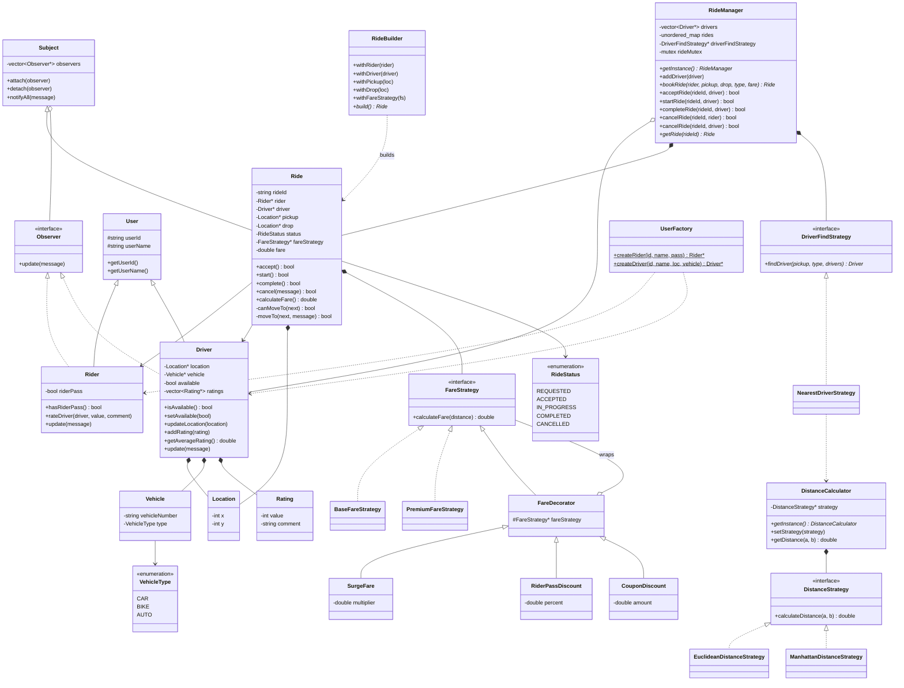
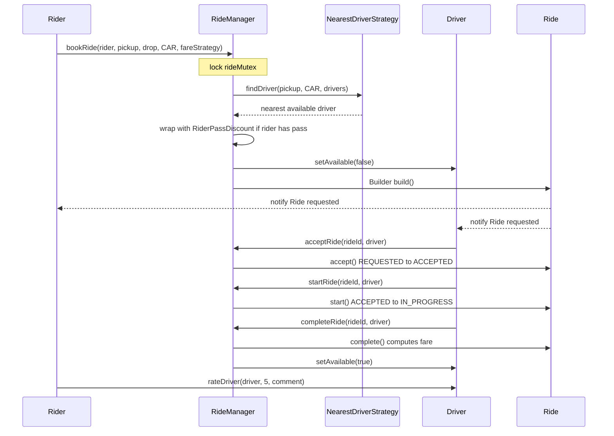
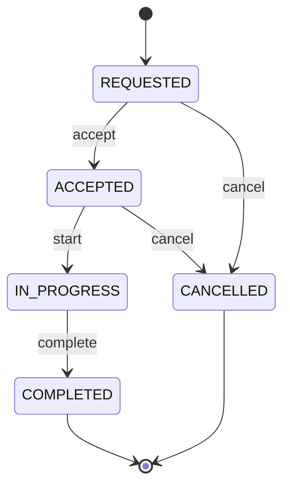

# Uber (Ride Booking System) — Low Level Design

[⬅ Back to index](../README.md)

**Code:** [`Uber.cpp`](./Uber.cpp) · C++17

## 1. Requirements

1. **Rider** can book a ride by providing **pickup** and **destination** locations.
2. Rider can choose a **vehicle type**: `CAR`, `BIKE` or `AUTO`.
3. System finds an **available driver** matching the requested vehicle type.
4. Driver can **accept** a ride request.
5. Rider can **cancel** a ride before it starts.
6. Driver can **cancel** a ride before it starts.
7. Driver can **start** an accepted ride.
8. Driver can **complete** a ride.
9. **Fare** is calculated using a fare strategy (surge / discounts stack on top).
10. Rider can **rate** the driver after a ride is completed.
11. Driver **location** can be updated.
12. Concurrent ride requests must **not assign the same driver** to multiple rides.

**User flow:** Rider enters pickup + destination → selects vehicle type → requests ride → `RideManager` finds nearest available driver → driver is notified → driver accepts → ride starts → driver completes → fare calculated → rider rates driver.

**Driver flow:** Receives ride request → Accept → Start → Complete (can also cancel before start).

## 2. Core Entities

| Entity | Responsibility |
|---|---|
| **RideManager** | Singleton. Owns drivers + rides, runs the booking workflow, holds the single `rideMutex` |
| **User** | Base class: `userId`, `userName` |
| **Rider** | `User` + `Observer`; has optional **rider pass** (10% discount); rates drivers |
| **Driver** | `User` + `Observer`; has `Location`, `Vehicle`, `available` flag, list of `Rating`s |
| **Vehicle** | Vehicle number + `VehicleType` |
| **Location** | `(x, y)` coordinates |
| **Ride** | `Subject`; holds rider, driver, pickup, drop, `RideStatus`, `FareStrategy`, fare; owns the state transitions |
| **FareStrategy** | Pricing from distance only (`Base`, `Premium`) |
| **FareDecorator** | `SurgeFare`, `RiderPassDiscount`, `CouponDiscount` wrap any `FareStrategy` |
| **DriverFindStrategy** | Driver matching (`NearestDriverStrategy`) |
| **DistanceCalculator / DistanceStrategy** | Singleton calculator with pluggable `Euclidean` / `Manhattan` distance |
| **Rating** | Value (1–5) + comment |
| **UserFactory** | Creates `Rider` / `Driver` |
| **Enums** | `VehicleType {CAR, BIKE, AUTO}`, `RideStatus {REQUESTED, ACCEPTED, IN_PROGRESS, COMPLETED, CANCELLED}` |

**Domain relationship:**

```
Rider -> Ride -> Driver
             |-> Vehicle (via Driver)
             |-> Pickup
             |-> Drop
```

## 3. Class Diagram



> `RideBuilder` = the nested class `Ride::Builder` in code.

## 4. Design Patterns Used

| Pattern | Where | Why |
|---|---|---|
| **Strategy** | `FareStrategy`, `DriverFindStrategy`, `DistanceStrategy` | Swap pricing / matching (nearest → highest-rated → lowest ETA) / distance (Euclidean → Manhattan → real maps) without touching `Ride` or `RideManager` |
| **Decorator** | `SurgeFare`, `RiderPassDiscount`, `CouponDiscount` over `FareDecorator` | Stack pricing rules at runtime without new subclasses per combination |
| **Observer** | `Ride` is `Subject`; `Rider` & `Driver` are `Observer`s | Every ride state change (requested/accepted/started/completed/cancelled) is pushed to both parties |
| **Singleton** | `RideManager`, `DistanceCalculator` (Meyers' static local) | One shared booking manager and lock; one global distance calculator |
| **Builder** | `Ride::Builder` | Readable construction of a `Ride` with many params; private `Ride` ctor |
| **Factory** | `UserFactory` | Central creation of `Rider` / `Driver` |
| **State (lightweight)** | `Ride::canMoveTo()` transition table | States have no behaviour, only allowed transitions → enum + table instead of a class per state |

**Decorator stacking example:**

```cpp
FareStrategy* fare =
    new CouponDiscount(
        new SurgeFare(new BaseFareStrategy(), 1.5),
        30
    );
```

`RideManager::bookRide` automatically wraps the strategy with `RiderPassDiscount(…, 10)` when the rider has a rider pass.

| Fare rule | Formula |
|---|---|
| `BaseFareStrategy` | `50 + distance * 10` |
| `PremiumFareStrategy` | `100 + distance * 20` |
| `SurgeFare` | `inner * multiplier` |
| `RiderPassDiscount` | `inner - percent% of inner` |
| `CouponDiscount` | `inner - amount` (floored at 0) |

## 5. Key Flows

### Book → Accept → Start → Complete → Rate



- No driver found → `bookRide` deletes pickup/drop/fareStrategy and returns `NULL`.
- Every `RideManager` action verifies **ownership** (`ride->getDriver() == driver` / `ride->getRider() == rider`).
- `complete()` computes fare = `fareStrategy->calculateFare(distance(pickup, drop))`; `FareStrategy` gets only the **distance**, not the `Ride`.
- Cancel (by rider or driver) frees the driver (`setAvailable(true)`).

### Ride state machine



`COMPLETED` and `CANCELLED` are terminal; any illegal transition makes `moveTo()` return `false` (no notification sent).

## 6. Concurrency & Edge Cases

- **Single `rideMutex`** in `RideManager` guards `drivers`, `rides`, `driverFindStrategy` and every ride action (`book/accept/start/complete/cancel/getRide`).
- **Find + reserve is atomic:** driver availability is checked (`findDriver`) and flipped (`setAvailable(false)`) under the **same lock** → two concurrent `bookRide` calls can never reserve the same driver (demo: two threads get Driver1 and Driver2; a third booking gets none).
- All ride actions go through `RideManager`, so **no entity calls back into the manager** and every state change stays inside one lock (no re-entrant locking).
- `rideId` generated from a `static atomic<int>` counter.
- **Invalid input handling:**
  - Unknown ride id / wrong rider or driver → `false`.
  - Illegal state transition (e.g. start before accept, cancel after start) → `false`.
  - Rating outside **1–5** → `"Invalid rating"`.
  - Coupon larger than fare → fare floors at **0**.
- **Ownership:** `Ride` owns pickup, drop and fare strategy; `Driver` owns its location, vehicle and ratings; `RideManager` owns rides; `FareDecorator` deletes its wrapped strategy.
- **Not enforced in code (good to mention):** `rateDriver` and `Driver::updateLocation` are not called through `RideManager`, so they are **not under the lock**, and rating does not check that the ride is `COMPLETED`.

## 7. How to Run

```bash
g++ -std=c++17 Uber.cpp -o uber && ./uber
```

(Uses `std::thread`; on Linux add `-pthread` if linking fails.)

---
### 🧠 Quick Revision

- **RideManager (Singleton)** is the only entry point; one **mutex** makes "find nearest driver + mark unavailable" atomic → no double-assignment.
- **Strategy ×3:** fare (`Base`/`Premium`), driver matching (`Nearest`), distance (`Euclidean`/`Manhattan`) — all pluggable.
- **Decorator** stacks surge, rider-pass (auto 10%), coupon on any base fare; fare strategy depends **only on distance**.
- **Observer:** `Ride` is the Subject; Rider + Driver auto-attached in the ctor and notified on every state change.
- **Builder** constructs `Ride`; **Factory** creates users.
- **State machine via transition table** (`canMoveTo`) — REQUESTED → ACCEPTED → IN_PROGRESS → COMPLETED, cancel allowed only before start.
- Every action checks **ride exists + caller owns it + transition legal**, else returns `false`.
- Extensions: highest-rated / lowest-ETA matching, real routing distance, new fare decorators — no changes to `Ride`.
