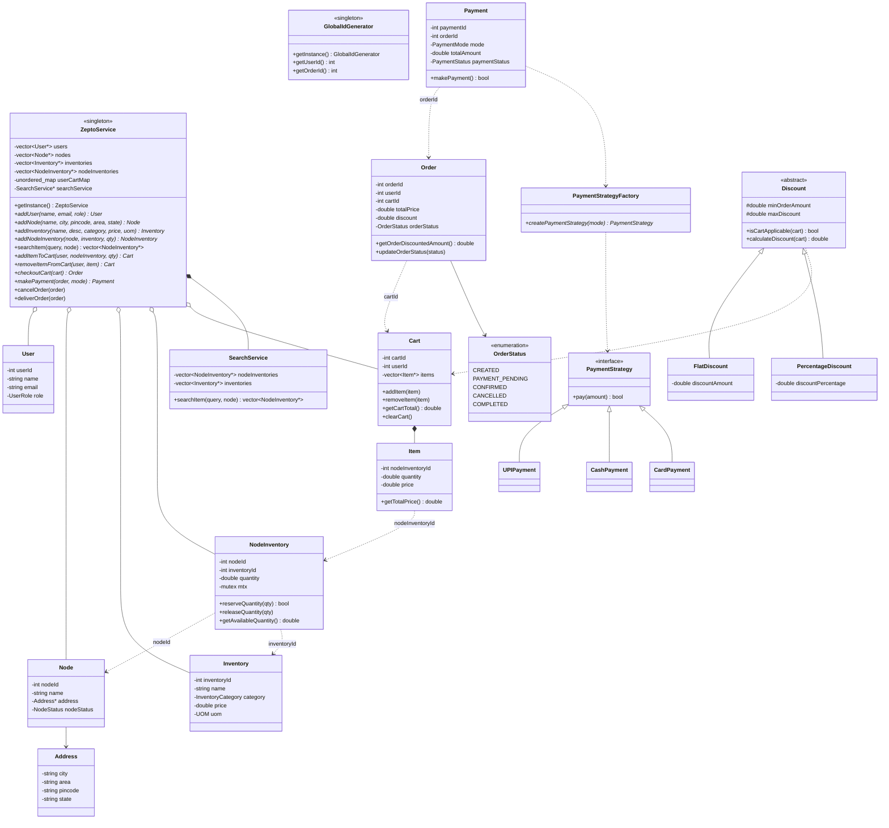
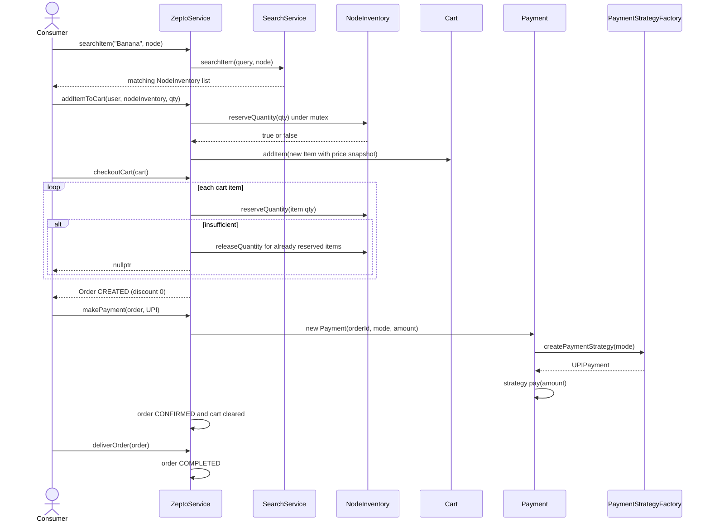
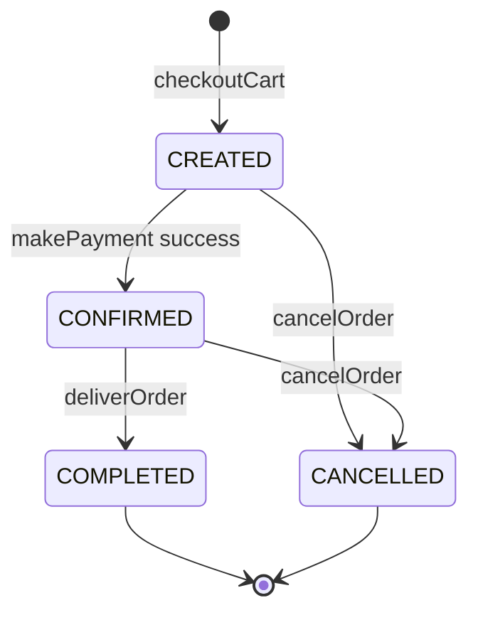

# Zepto (Quick-Commerce Grocery Delivery) — Low Level Design

[⬅ Back to index](../README.md)

**Code:** [`zepto.cpp`](./zepto.cpp) · C++17 · Notes: [`zepto.txt`](./zepto.txt)

## 1. Requirements

**Functional**

| Actor | Requirement |
|---|---|
| **User** | Search items (at a node / dark store) |
| | Add or remove items to/from cart |
| | Place an order (checkout cart) |
| | Make payment for the order |
| **Admin** | Add a **Node** (dark store) |
| | Add **inventory** to a node |
| | Handle **discounts** on orders |
| **Delivery Partner** | Pick the order from the node |
| | Drop the order at the user's address (`deliverOrder` → `COMPLETED`) |

**Non-functional**
1. **Concurrency** while updating node inventory.
2. **Duplicate payment** handling.
3. **Extensibility** — easily add new payment methods and discount types.

**Out of scope:** order rating · order tracking · notifications · delivery-partner selection · delivery-partner flow.

## 2. Core Entities

| Entity | Responsibility |
|---|---|
| `ZeptoService` | **Singleton** facade: users, nodes, inventories, carts; add-to-cart, checkout, pay, cancel, deliver |
| `GlobalIdGenerator` | **Singleton** that hands out auto-increment IDs per entity type |
| `User` | id, name, email, `UserRole` (CONSUMER / ADMIN / DELIVERY_PARTNER) |
| `Node` | Dark store / warehouse: name, `Address`, `NodeStatus` |
| `Address` | city, area, pincode, state |
| `Inventory` | Catalog product: name, description, category, price, UOM |
| `NodeInventory` | **Stock of one product at one node** (quantity) + its own `mutex` |
| `Item` | Cart line: nodeInventoryId, quantity, price snapshot |
| `Cart` | One per user (`userCartMap`); add / remove / total / clear |
| `Order` | userId, cartId, totalPrice, discount, `OrderStatus` |
| `Payment` | paymentId, orderId, mode, amount, `PaymentStatus` |
| `PaymentStrategy` (+ UPI / Cash / Card) | Pluggable payment method |
| `PaymentStrategyFactory` | Creates the strategy from a `PaymentMode` |
| `Discount` (+ `FlatDiscount`, `PercentageDiscount`) | Pluggable discount rules with min order amount and max cap |
| `SearchService` | Substring search of product names within a node |

## 3. Class Diagram



**Key modelling idea:** `Inventory` = *what* the product is (catalog, price); `NodeInventory` = *how much* of it a specific dark store has. Entities link by **IDs** (DB-style foreign keys) rather than pointers.

## 4. Design Patterns Used

| Pattern | Where | Why |
|---|---|---|
| **Singleton** | `ZeptoService`, `GlobalIdGenerator` (Meyers' static local, copy deleted) | One service instance / one global ID sequence |
| **Strategy** | `PaymentStrategy` → `UPIPayment` / `CashPayment` / `CardPayment` | New payment methods without changing `Payment` (NFR 3) |
| **Factory** | `PaymentStrategyFactory::createPaymentStrategy(PaymentMode)` | Decouples `Payment` from concrete strategy classes |
| **Strategy (template)** | `Discount` → `FlatDiscount` / `PercentageDiscount` | New discount types plug in via `isCartApplicable` + `calculateDiscount` (NFR 3) |
| **Facade** | `ZeptoService` | Single API for search, cart, order, payment, delivery |

## 5. Key Flows

### Add to cart → checkout → pay → deliver



- **Checkout is all-or-nothing:** if any line can't be reserved, the already-reserved lines are **rolled back** via `releaseQuantity`.
- **Cancel:** `cancelOrder` releases every cart item's quantity back to its `NodeInventory` and marks the order `CANCELLED`.
- **Price snapshot:** `Item` stores the price at add-to-cart time.

### Order state machine (as coded)



`PAYMENT_PENDING` exists in the enum but no code path sets it.

## 6. Concurrency & Edge Cases

| Concern | How it's handled |
|---|---|
| **Concurrent stock updates** | Each `NodeInventory` has its **own `mutex`** (fine-grained, per product per node); `reserveQuantity` does check-and-decrement atomically |
| **Overselling** | `reserveQuantity` fails if `quantity < requested` |
| **Partial checkout failure** | Rollback of already-reserved items |
| **Invalid quantity** | `quantity <= 0` rejected in `addItemToCart` and `reserveQuantity` |
| **Duplicate user** | `addUser` rejects an email that already exists |
| **Payment failure** | `PaymentStatus::FAILED`, order stays `CREATED`, cart kept |

**⚠️ Known gaps in the current code (good to mention as improvements)**
- `NodeInventory::reserveQuantity` returns `false` on insufficient stock **without unlocking the mutex** → next call on that item deadlocks. Use `lock_guard<mutex>`.
- Stock is reserved **twice** — once in `addItemToCart` and again in `checkoutCart`; `removeItemFromCart` doesn't release the reservation.
- `ZeptoService::makePayment` is declared to return `Payment*` but has **no `return`** (UB — the GCC build traps at the end of `main`).
- **Duplicate payment** (NFR 2) is not enforced yet — `makePayment` doesn't check the order is still `CREATED`. Fix: reject if status != `CREATED` / idempotency key per order.
- `Discount` classes exist but are **never applied** (orders are created with discount `0`); `FlatDiscount` ignores `maxDiscount`.
- `ZeptoService` maps (`users`, `userCartMap`, …) are not thread-safe; roles and `NodeStatus` are not enforced; search is case-sensitive.
- Raw `new` everywhere and no destructors (leaks, incl. strategy objects from the factory).

## 7. How to Run

```bash
g++ -std=c++17 zepto.cpp -o zepto && ./zepto
```

> **macOS note:** the file includes `<bits/stdc++.h>`, which is GCC-only. Apple's `g++` (really clang) fails with `'bits/stdc++.h' file not found` — use Homebrew GCC (`g++-15 -std=c++17 ...`) or replace it with standard headers.

Expected output:

```
Item added to Cart
Item added to Cart
Order Created Successfully
300 Rs. Paid Successfully via UPI
```

---
### 🧠 Quick Revision
- **Inventory vs NodeInventory:** catalog product vs stock of that product at a specific dark store.
- **Per-`NodeInventory` mutex** → fine-grained locking; check-and-decrement is atomic, so no overselling.
- **Checkout = reserve all or roll back all** (compensating `releaseQuantity`).
- **Strategy + Factory** for payments; **Strategy** for discounts (flat / percentage with min order and max cap) → extensibility NFR.
- **Singletons:** `ZeptoService` facade and `GlobalIdGenerator` (Meyers' singleton, copy deleted).
- Order lifecycle: `CREATED → CONFIRMED → COMPLETED`, or `CANCELLED` (releases stock).
- **Duplicate payment:** guard on order status + idempotency key per order (talking point; not yet coded).
- Out of scope by design: tracking, rating, notifications, partner assignment.
